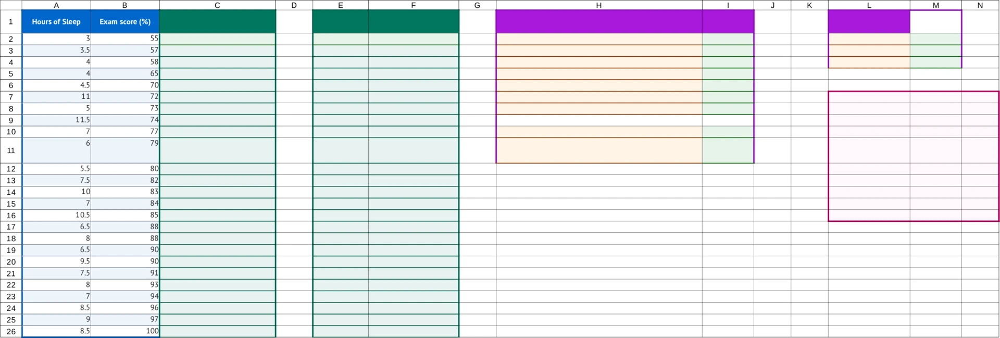

# markdown-to-tutorial

Write science lessons in Markdown, then build editable Word instructions, student workbooks, and
review PDFs from the same source.

## Screenshots

<!-- screenshots:begin (managed by screenshot-docs) -->



<!-- screenshots:end -->

The opening shows the Caffeine 3 lesson's sleep-and-exam-score story, followed by a compact formula
and fill-down instruction. The workbook view shows the full student workbook: blue source data,
teal calculations, orange results, and purple interpretation areas. Student working areas are
intentionally blank. The repository includes 12 lessons; PETase uses an explicitly synthetic
dataset.

Google Docs and Sheets import and execution have not been verified. The quick start below builds
editable DOCX instructions and an XLSX workbook locally.

## Quick start

Install the Python requirements as described in [docs/INSTALL.md](docs/INSTALL.md), then lint and build a lesson:

```bash
source source_me.sh
python3 make_tutorial.py lint tutorial_data/caffeine_3_quadratic_regression.md
python3 make_tutorial.py build tutorial_data/caffeine_3_quadratic_regression.md --format docx,xlsx
```

The files appear in `tutorial_output/caffeine_3_quadratic_regression/`. PDF output requires
LibreOffice and the fonts listed in [docs/INSTALL.md](docs/INSTALL.md); to build all three formats,
run `python3 make_tutorial.py build tutorial_data/caffeine_3_quadratic_regression.md --format all`.
Lint checks source structure and workbook references; it does not run spreadsheet formulas. Local
formula checks and student outcomes are separate evidence questions.

## Write instructions in context

Keep the student's explanation in your own voice. Semantic links attach a cell action to the words
students already read; the destination stays hidden in the generated document. This excerpt is from
the [Caffeine 3 lesson](tutorial_data/caffeine_3_quadratic_regression.md):

```markdown
#### Step: **Create a SQUARED Sleep-Hours Column**

To let our regression model curve, we need to square our predictor variable (x).

1. Use blank column C in your spreadsheet.\
2. Label it [Sleep Hours Squared (x^2)](label:C1)\
3. If the sleep hours are in cell A2, enter: [=A2^2](enter:C2)\
4. Press Enter, then [drag the little blue square all the way down to the bottom](fill:C2:C26) to
   make sure it applies to all students! Basically, we&#8217;re taking each student&#8217;s hours of sleep
   and multiplying that number by itself. If someone slept 6 hours, their squared sleep value is
   36! Don&#8217;t worry, they didn&#8217;t sleep for 36 hours!
```

Workbook region roles identify starting data, calculations, results, and interpretation. A clearly
bounded bare formula such as `=SUM(A1:A3)` receives automatic styling; it does not declare a cell
action.

<details>
<summary>Full runnable authoring example</summary>

The following small source builds as written. A semantic link binds the visible wording to a checked cell target while keeping the authored paragraph intact.

```markdown
# Squared sleep hours

## Workbook

### Sheet: Sleep

| Hours slept | Exam score |
| --- | --- |
| 6 | 80 |
| 8 | 92 |

- **Region A1:B3:** source
- **Region C1:C3:** calculation
- **Region E1:F2:** results
- **Region H1:I2:** interpretation

#### At: E1

| Measure | Result |
| --- | --- |
| Mean squared hours | |

#### At: H1

| Prompt | Response |
| --- | --- |
| What might a curve capture? | |

## Tutorial

### Part: Prepare the predictor

- **Worksheet:** Sleep

#### Step: Square sleep hours

Use column C for the squared predictor. In C1, label [Sleep hours squared (x^2)](label:C1); in C2, enter [=A2^2](enter:C2), then [fill the formula through row 3](fill:C2:C3). Each value stays paired with the same student's score.

#### Step: Summarize the predictor

In F2, enter [=AVERAGE(C2:C3)](enter:F2). Then explain what a curved pattern could capture in I2.
```

</details>

## What the project provides

- One editable Markdown source for lesson prose, workbook data, and cell actions.
- DOCX instructions, XLSX student workbooks with blank answer cells, and PDF review copies.
- Workbook regions marked as source data, calculations, results, or interpretation.
- Offline checks for source structure, workbook labels, and cell references.
- A draft importer that creates a Markdown scaffold from a simple XLSX workbook.

## Documentation

- [docs/INSTALL.md](docs/INSTALL.md) - Install Python requirements, LibreOffice, and the required fonts.
- [docs/USAGE.md](docs/USAGE.md) - Run lint, build outputs, import workbooks, and validate calculations.
- [docs/AUTHORING_GUIDE.md](docs/AUTHORING_GUIDE.md) - Write lesson prose, semantic actions, and workbook tables.
- [docs/TUTORIAL_CATALOG.md](docs/TUTORIAL_CATALOG.md) - Browse all 12 lesson sources and data notes.
- [docs/TUTORIAL_SPEC.md](docs/TUTORIAL_SPEC.md) - Read the complete source and output contract.
- [docs/GOOGLE_SHEETS_VALIDATION.md](docs/GOOGLE_SHEETS_VALIDATION.md) - Review the separate Google validation scope and evidence.

The source code is licensed under the [MIT License](LICENSE.MIT).
