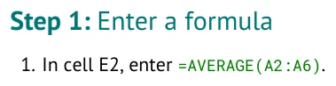

# Authoring guide

You have worked through several BIOL 318 tutorials. Now you can write one for your classmates.
This guide teaches the Markdown and compiler features that turn your source into a Word document,
an Excel workbook, and a PDF. Bring your own scenario, research question, explanations, and approach
to teaching them.

Your tutorial contributes to the class's growing collection of Student-Generated Content (SGC).
That is the open-pedagogy purpose of this project: students create educational materials that
others can use. The compiler keeps their presentation consistent while preserving your words.

## Find what you need

| I want to... | Open |
| --- | --- |
| See what a Markdown feature produces | [FORMATTING_GUIDE.md](FORMATTING_GUIDE.md) |
| Format the document | Part 1: [learn/PART_1_CREATE.md](learn/PART_1_CREATE.md) |
| Construct the supplied workbook | Part 2: [learn/PART_2_STATISTICS.md](learn/PART_2_STATISTICS.md) |
| Build, inspect, and correct my files | Part 3: [learn/PART_3_IMPROVE.md](learn/PART_3_IMPROVE.md) |
| Look up exact syntax and limits | [TUTORIAL_SPEC.md](TUTORIAL_SPEC.md) |

Read the Parts in order or open the feature you need. You do not need to complete an example
lesson first. Roots supplies a few values for formatting demonstrations; it has no required
scenario or project to reproduce.

## Source becomes output

**You type this in your Tutorial section:**

```markdown
#### Step: Enter a formula

1. In cell E2, enter [`=AVERAGE(A2:A6)`](enter:E2).
```

**The compiler produces this Word instruction:**



E2 stays blank in the supplied Excel workbook. The instruction asks your reader to fill it.
The complete runnable source is [examples/authoring_features.md](examples/authoring_features.md).
Use GitHub's **Raw** view to copy a complete source; rendered pages can hide action-link targets.

## Write your own content

An authoring outline can show where your prose goes. This is **instructional notation**, not a
runnable example. Replace every angle-bracket placeholder with your own text before building:

```text
### Part: <your part title>

<biological scenario>

<research question>

#### Step: <your step title>

<setup paragraph>

1. <your instruction>

<interpretation>
```

These are possible places for content, not required sections or a prescribed narrative.
Use the structure that fits your tutorial. The compiler treats actual Part and Step headings as
structure; it does not fill placeholders or write explanations.

## Keep one source of truth

Your `.md` file contains both the Workbook tables and the Tutorial text. Keep companion images
with it. Edit that source and rebuild when you revise your tutorial; edits made only in generated
Word or Excel files do not flow back into Markdown.

The compiler controls fonts, colors, spacing, numbering, and worksheet presentation. You choose
the data, supplied labels, blank work areas, formulas, and wording. A successful build verifies
supported technical rules, not whether the science or teaching is sound.

## Check the finished tutorial

Before sharing, follow your instructions using a fresh copy of the generated workbook. Check
the actual calculations in your spreadsheet application, then reopen the supplied starter to
confirm that the reader's work cells are blank.

The following are author and instructor judgments, separate from compiler validation:

- Does the tutorial explain its question and what the reader will learn?
- Can a classmate follow the instructions and interpret the results?
- Are the scientific claims, assumptions, and calculations appropriate?
- Are supplied data, images, and borrowed material credited, including synthetic data?

The instructor's z-test tutorials show finished materials you may recognize:
[../tutorial_data/babies_1_z_test.md](../tutorial_data/babies_1_z_test.md) and
[../tutorial_data/microbes_1_z_test.md](../tutorial_data/microbes_1_z_test.md).
They illustrate the expected quality and the compiler's output; choose your own content.
Other examples are in [TUTORIAL_CATALOG.md](TUTORIAL_CATALOG.md).

For installation, use [INSTALL.md](INSTALL.md). Command details are in [USAGE.md](USAGE.md).
