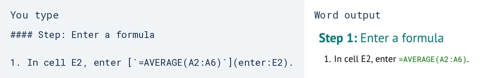
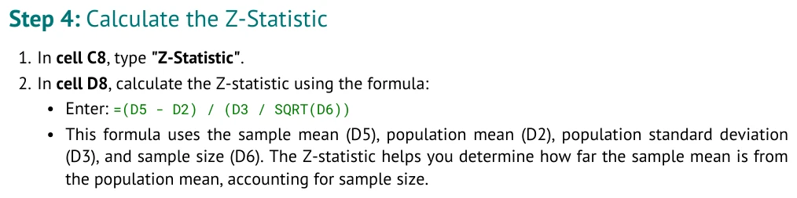

# Markdown to Word and Excel

Find the feature you want, copy its source pattern, and use it in your own tutorial.
This visual reference shows actual compiler output. The three-part
[AUTHORING_GUIDE.md](AUTHORING_GUIDE.md) explains how the pieces fit together.

## Find a feature

| I want to... | Example below | More detail |
| --- | --- | --- |
| Organize a document and number its instructions | [Headings and lists](#headings-and-lists) | [reference/MARKDOWN.md](reference/MARKDOWN.md) |
| Emphasize text or show scientific notation | [Text and symbols](#text-and-symbols) | [reference/MARKDOWN.md](reference/MARKDOWN.md) |
| Add a document table, figure, or link | [Tables, images, and links](#tables-images-and-links) | [reference/MARKDOWN.md](reference/MARKDOWN.md) |
| Supply worksheet data and blank work cells | [Workbook layout](#workbook-layout) | [reference/WORKSHEETS.md](reference/WORKSHEETS.md) |
| Give results and responses visible work areas | [Results and responses](#results-and-responses) | [reference/WORKSHEETS.md](reference/WORKSHEETS.md) |
| Format a formula and connect it to a cell | [Formula instructions](#formula-instructions) | [reference/FORMULAS.md](reference/FORMULAS.md) |
| Fill a column or select a range | [Fill and select](#fill-and-select) | [reference/ACTIONS.md](reference/ACTIONS.md) |
| Replace a value or offer alternative calculations | [Replace and alternatives](#replace-and-alternatives) | [reference/ACTIONS.md](reference/ACTIONS.md) |
| Supply my own prose | [Content placeholders](#content-placeholders) | [learn/PART_1_CREATE.md](learn/PART_1_CREATE.md) |
| Correct a build error | [Build and check](#build-and-check) | [reference/MISTAKES.md](reference/MISTAKES.md) |
| Move tables, resize data, or import a workbook | [Optional tools](#optional-tools) | [reference/CHANGES.md](reference/CHANGES.md) |

The snippets below come from one runnable file:
[examples/authoring_features.md](examples/authoring_features.md). Roots is a small formatting
example, not a lesson to complete. Copy a complete file from GitHub's **Raw** view; use the fenced
snippets below when copying a specific feature. Each fragment belongs in the indicated section.

## Headings and lists

The document title and opening paragraph come directly from the beginning of the file:

```markdown
# Roots formatting examples

Five invented root lengths provide small tables for demonstrating document and workbook formatting.
```


**You type in Tutorial:**

```markdown
### Part: Format the document

- **Worksheet:** Roots

#### Step: Organize instructions

1. Read the supplied column headings.
   - The measurements are in column A.
   - Column B is reserved for your calculations.
2. Keep your explanation beside the instruction it supports.

##### Substep: Add a detail

This paragraph belongs to the substep.
```

**Word output:**


The compiler numbers Parts and Steps and gives nested instructions their own indentation.
Use descriptive names from your own tutorial. A `#` title starts the file; `## Workbook`
and `## Tutorial` separate spreadsheet content from document content.

## Text and symbols

**You type:**

```markdown
##### Explanation: Mark up scientific text

Use **bold** for emphasis, *italics* for a distinction, and `A2` for a literal cell address.
Scientific text can include &alpha;, H<sub>0</sub>, and mm<sup>2</sup>.

> A short note appears as a separate block.
```

**Word output:**


Keep source characters ASCII. Named entities and the supported `sub` and `sup` tags let you
write scientific notation. The compiler chooses the fonts and colors; you supply the emphasis.

## Tables, images, and links

A table inside Tutorial becomes a Word table:

```markdown
#### Step: Show a document table

| Item | Location |
| --- | --- |
| Measurements | A2:A6 |
| Mean | E2 |
```


An image uses a path relative to your Markdown file. This excerpt's path is relative to the
complete example under `docs/examples/`; adjust it for your own file location.

```markdown
#### Step: Include an image


This image comes from the instructor's Microbes z-test tutorial.
```


Keep the descriptive text inside `![...]` so the image has alternative text. Local PNG, JPEG,
and WebP images are supported. Keep your image files with the source you share.

Link to a heading using its Markdown anchor:

```markdown
#### Step: Link to a section

Return to the [instruction example](#step-organize-instructions).
```


Use a heading link when directing readers to another step; a typed step number can become stale.
Ordinary web links use the same `[visible words](destination)` pattern.

## Workbook layout

**You type under Workbook:**

```markdown
### Sheet: Roots

| Root length (mm) | Squared length (mm^2) |
| --- | --- |
| 12 | |
| 15 | |
| 18 | |
| 20 | |
| 25 | |

- **Region A1:A6:** source
- **Region B1:B6:** calculation
```

**Excel output**, shown with the additional result table defined next:


The first table starts at A1. Its header becomes row 1; the Markdown separator does not become
a spreadsheet row. Empty entries supply blank cells. Region declarations apply worksheet styling
without adding labels or answers. Numeric and blank work cells display three decimal places by
default; the stored precision is unchanged.

Use `#### At: D1` before another table to set its upper-left cell. Each additional table needs
its own placement. See [reference/WORKSHEETS.md](reference/WORKSHEETS.md) for text-versus-number
rules, literal quotes, multiple worksheets, and optional Google links.

## Results and responses

**You type under the same Sheet:**

```markdown
#### At: D1

| Statistic | Value |
| --- | --- |
| Mean (mm) | |
| Example choice | |

- **Region D1:E3:** results
```

**Excel output:**


A response area uses the same table syntax and an interpretation region:

```markdown
#### At: D8

| Interpretation | Response |
| --- | --- |
| Your explanation | |

- **Region D8:E9:** interpretation
```


Replace these demonstration labels with wording appropriate to your tutorial. The region gives
a response space its presentation; it does not generate an interpretation or evaluate a response.

## Formula instructions

**You type inside a Tutorial Part:**

```markdown
#### Step: Enter a formula

1. In cell E2, enter [`=AVERAGE(A2:A6)`](enter:E2).
```

**Source beside actual Word output:**



The link's text is visible. Its `enter:E2` destination connects the instruction to a cell and
stays hidden in Word. Name E2 in the visible instruction as well. The compiler styles the formula
and checks supported references; the spreadsheet application calculates it.

Put a formula in a Workbook table when you want it supplied in advance. Put it in a Tutorial
Enter action when the reader should enter it. Leave that starter cell blank.

The same action-link syntax preserves the wording of an instructor's longer instruction. This
excerpt is from [../tutorial_data/microbes_1_z_test.md](../tutorial_data/microbes_1_z_test.md):

```markdown
#### Step: Calculate the Z-Statistic

1. In **cell C8**, type **"[Z-Statistic](label:C8)"**.
2. In **cell D8**, calculate the Z-statistic using the formula:
   * Enter: [`=(D5 - D2) / (D3 / SQRT(D6))`](enter:D8)
   * This formula uses the sample mean (D5), population mean (D2), population standard deviation (D3), and sample size (D6). The Z-statistic helps you determine how far the sample mean is from the population mean, accounting for sample size.
```



The source's nested list and explanation survive the conversion. Your words can use the same
formatting without adopting this scenario. This older lesson teaches label entry; normally supply
labels in your Workbook tables.

## Fill and select

**You type:**

```markdown
#### Step: Fill a column

1. In cell B2, enter [`=A2^2`](enter:B2).
2. [Fill B2:B6](fill:B2:B6) down.
```

**Word output:**


Fill uses the first row's formula. The compiler checks the translated references while keeping
the supplied workbook's work cells blank. See [reference/FORMULAS.md](reference/FORMULAS.md) for
formula notation and its validation limits.

```markdown
#### Step: Select a range

1. [Select A1:B6](select:A1:B6).
2. Choose **Insert > Chart** in your spreadsheet application.

The instruction appears in the document; the reader creates the chart.
```


Selection and menu instructions describe reader actions. They do not create a chart in the
generated workbook.

## Replace and alternatives

**You type:**

```markdown
#### Step: Replace a supplied value

1. In cell A2, replace the supplied value with [14](replace:A2).
```


Replace requires a value supplied in Workbook or established earlier in the instructions.
The starting workbook still contains the original value.

When readers choose between calculations for the same destination, declare the alternatives:

```markdown
#### Step: Provide a choice

Choose one of these demonstration formulas for E3.

- **Alternative: Minimum**
  - In cell E3, enter [`=MIN(A2:A6)`](enter:E3).
- **Alternative: Maximum**
  - In cell E3, enter [`=MAX(A2:A6)`](enter:E3).
```


The compiler checks the branches separately. These are reader choices, not automatic conditions.
See [reference/ACTIONS.md](reference/ACTIONS.md) for Label, legacy action openings, and sequencing.

## Content placeholders

Use an outline to leave room for your own writing. This is **instructional notation**, not
runnable compiler source. Replace the placeholders before using the fragment:

```text
### Part: <your title>

<biological scenario>

<research question>

#### Step: <your title>

<setup paragraph>

1. <instruction in your own words>

<interpretation>
```

These placeholders suggest where prose can go; they do not require a particular narrative or
section sequence. The compiler formats what you write.

## Build and check

Use [learn/PART_3_IMPROVE.md](learn/PART_3_IMPROVE.md) for the normal build-and-review workflow.
A short check of the complete feature example, after [INSTALL.md](INSTALL.md):

```bash
source source_me.sh
python3 make_tutorial.py lint docs/examples/authoring_features.md
python3 make_tutorial.py build docs/examples/authoring_features.md --format docx,xlsx
```

The output is in `tutorial_output/authoring_features/`. For PDF, build with `--format all`.
Screenshots here show the actual DOCX rendered through LibreOffice and the XLSX printed through
Calc. They do not establish identical Google Docs or Sheets rendering.

The compiler checks supported structure, references, and assignment consistency. You and your
instructor judge the scientific content and whether the tutorial teaches well. A successful
build does not establish either.

## Optional tools

- [reference/CHANGES.md](reference/CHANGES.md) covers previewing coordinated worksheet edits.
- [USAGE.md](USAGE.md#import-a-workbook) explains importing simple XLSX data as a Markdown draft.
- [TUTORIAL_SPEC.md](TUTORIAL_SPEC.md) defines the full syntax and limits. Task lists, footnotes,
  raw HTML beyond the supported inline tags, and full mathematical typesetting are not supported.
- [screenshots/README.md](screenshots/README.md) records native screenshot provenance and the
  existing refresh command for maintainers.
