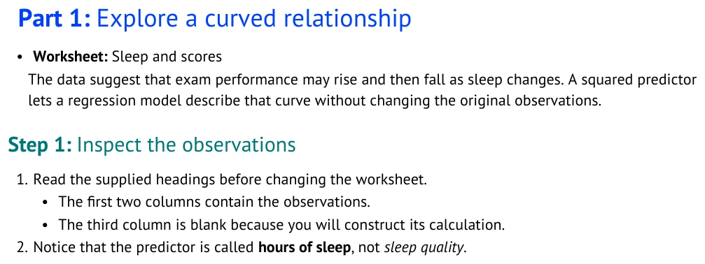
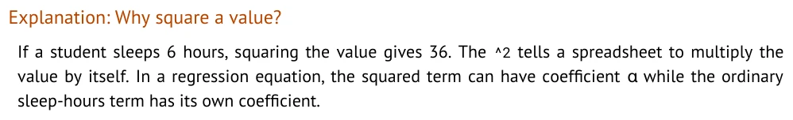
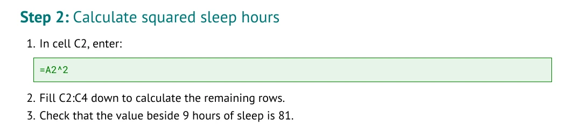
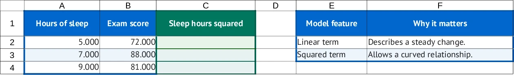

# From Markdown to formatting

Copy a pattern, replace the words with your own, and build your tutorial. The compiler supplies
fonts, colors, spacing, and numbering. You decide what the lesson says and what students do.

The examples below come from [examples/formatting_demo.md](examples/formatting_demo.md).
Each source block is followed by a cropped view of its actual rendered output.
Write plain ASCII: straight quotes, ordinary hyphens, and readable symbols such as `&alpha;`.

## Headings and nested instructions

Use `Part:` and `Step:` to organize the lesson. The compiler adds their numbering. Indent a bullet
under a numbered item to keep related details together.

```markdown
### Part: Explore a curved relationship

- **Worksheet:** Sleep and scores

The data suggest that exam performance may rise and then fall as sleep changes. A squared predictor
lets a regression model describe that curve without changing the original observations.

#### Step: Inspect the observations

1. Read the supplied headings before changing the worksheet.
   - The first two columns contain the observations.
   - The third column is blank because you will construct its calculation.
2. Notice that the predictor is called **hours of sleep**, not *sleep quality*.
```

The Step heading sits farther left than the body text. Colors, sizes, and spacing distinguish the
levels without author-written formatting commands.

<!-- screenshots:begin (managed by screenshot-docs) -->

<!-- screenshots:end -->

## Emphasis and scientific symbols

Use `**bold**` for emphasis, `*italics*` for a distinction, and backticks for literal spreadsheet
text. Type `&alpha;` to show the Greek letter while keeping the source ASCII.

```markdown
##### Explanation: Why square a value?

If a student sleeps 6 hours, squaring the value gives 36. The `^2` tells a spreadsheet to multiply
the value by itself. In a regression equation, the squared term can have coefficient &alpha; while
the ordinary sleep-hours term has its own coefficient.
```

The smaller explanation heading separates the reasoning from the task. Long prose receives full
justification automatically, using an estimated line count; no alignment syntax is needed.

<!-- screenshots:begin (managed by screenshot-docs) -->

<!-- screenshots:end -->

## Formulas and spreadsheet actions

Keep ordinary Excel formulas in your instructions. The text inside square brackets is visible;
`(enter:C2)` records where the student enters it. The destination stays hidden in the document.

```markdown
#### Step: Calculate squared sleep hours

1. In cell C2, enter:
   [`=A2^2`](enter:C2)
2. [Fill C2:C4](fill:C2:C4) down to calculate the remaining rows.
3. Check that the value beside 9 hours of sleep is 81.
```

Put the formula on its own indented line after the introduction to give it a prominent green block.
A formula within a sentence stays inline. The workbook leaves C2:C4 blank for
students to calculate. These action links also let the compiler check the calculation sequence.
Keep the destination visible in your sentence so students know where to work.

<!-- screenshots:begin (managed by screenshot-docs) -->

<!-- screenshots:end -->

## Tables in the tutorial

A table inside `## Tutorial` becomes a document table. It does not add cells to the workbook.

```markdown
| Model feature | What to record |
| --- | --- |
| Linear term | How the response changes in a straight-line model. |
| Squared term | How the curve bends as sleep changes. |
```

The compiler supplies the header styling, borders, and alternating row shading.

<!-- screenshots:begin (managed by screenshot-docs) -->

<!-- screenshots:end -->

## Tables in the workbook

Put the labels and data students should receive under `## Workbook`. The first table starts at A1;
`At: E1` places the next table where you choose. Empty entries stay empty.

```markdown
## Workbook

### Sheet: Sleep and scores

| Hours of sleep | Exam score | Sleep hours squared |
| --- | --- | --- |
| 5 | 72 | |
| 7 | 88 | |
| 9 | 81 | |

- **Region A1:B4:** source
- **Region C1:C4:** calculation

#### At: E1

| Model feature | Why it matters |
| --- | --- |
| Linear term | Describes a steady change. |
| Squared term | Allows a curved relationship. |
```

This is the starting workbook, with supplied headings and blank calculation cells. The author
chooses the arrangement and content; the compiler adds presentation. A region description does
not create a heading: write the heading in the table itself.

Numbers display three decimal places by default. The blank calculation cells use that format too,
so student-entered results match. Stored values keep their full precision; this is display
formatting, not rounding the data.

<!-- screenshots:begin (managed by screenshot-docs) -->

<!-- screenshots:end -->

## Try the complete example

Run from the repository root:

```bash
source source_me.sh
python3 make_tutorial.py lint docs/examples/formatting_demo.md
python3 make_tutorial.py build docs/examples/formatting_demo.md --format all
```

Open the DOCX, PDF, and XLSX in `tutorial_output/formatting_demo/`. PDF export requires LibreOffice
and the fonts listed in [INSTALL.md](INSTALL.md). On this macOS host, agent commands that invoke
LibreOffice must run outside the sandbox.

The screenshots show local PDF rendering and a printed view of the XLSX. Page wrapping can differ
in other applications; these are not Google Docs or Google Sheets screenshots.

For writing a complete lesson, use [AUTHORING_GUIDE.md](AUTHORING_GUIDE.md). For all supported
syntax and its rules, see [TUTORIAL_SPEC.md](TUTORIAL_SPEC.md).

## Refresh the screenshots

For maintainers: [../devel/capture_syntax_examples.py](../devel/capture_syntax_examples.py) builds
the example in a temporary directory and captures the same five views. It uses LibreOffice,
Poppler, WebP, and the screenshot skill's artifact renderer. Run outside the macOS sandbox:

```bash
source source_me.sh && python3 devel/capture_syntax_examples.py \
  --artifact-renderer /Users/vosslab/nsh/vosslab-skills/skills/documentation/screenshot-docs/scripts/render_artifact_libreoffice.sh
```

On another checkout, use the location of your installed `render_artifact_libreoffice.sh`.
The [capture receipt](screenshots/syntax_capture_receipt.json) records the source and image hashes.
The narrow crops keep each feature readable; they intentionally omit unrelated page content.
