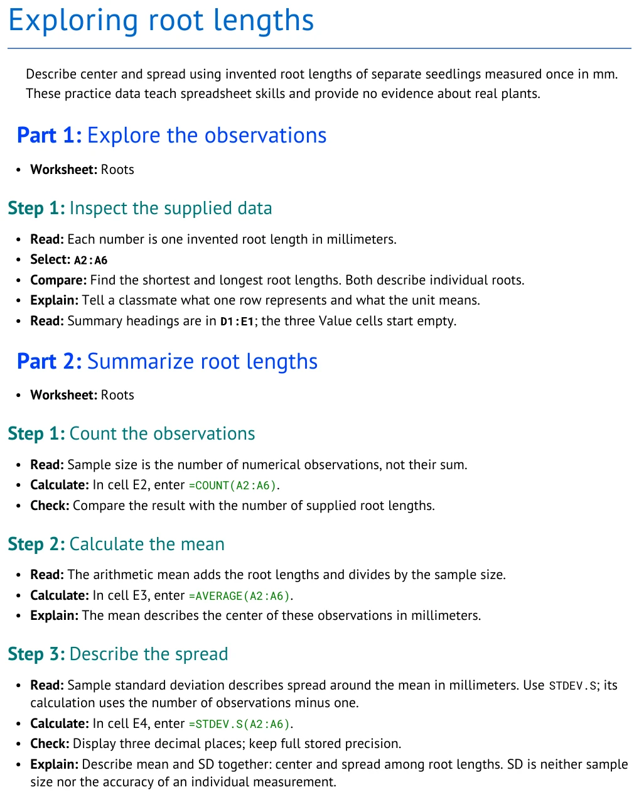

# Student guide

Make a small tutorial for a classmate, then turn it into an editable document and spreadsheet.
You can explore the examples before installing the software. Start with the three-part Roots lesson;
it teaches the writing and spreadsheet actions as you build one source file.

<!-- screenshots:begin (managed by screenshot-docs) -->

<!-- screenshots:end -->

## Make your first tutorial

1. [Part 1: Create your tutorial](learn/PART_1_CREATE.md) helps you inspect the finished lesson,
   copy a starting source, and write simple Markdown.
2. [Part 2: Add the statistics](learn/PART_2_STATISTICS.md) teaches `COUNT`, `AVERAGE`, and
   `STDEV.S`. Finish this Part to complete your first tutorial.
3. [Part 3: Improve and share](learn/PART_3_IMPROVE.md) is optional. Add a deviation column, fill
   formulas down while keeping a fixed mean reference, and ask a classmate to check the lesson.

Keep editing one file, `my_roots_tutorial.md`, through the Parts. The Roots values (12, 15, 18, 20,
and 25 mm) are invented practice data. The workbook already has the labels and summary area;
students fill the result cells.

The supplied workbook puts its summary at `D1:E4`; the reader fills `E2:E4`.
The completed calculation picture is a separate demonstration, not the supplied starter.

## View a published example

The finished lesson source and its editable outputs are available together:

- [Markdown source](examples/authoring_course/published/root_statistics.md)
- [Word document](examples/authoring_course/published/root_statistics.docx)
- [PDF document](examples/authoring_course/published/root_statistics.pdf)
- [Excel workbook](examples/authoring_course/published/root_statistics.xlsx)

## Find an example

Each checkpoint is a complete copy of the source at one stage. Open the closest point to your work:

| Checkpoint | What it shows |
| --- | --- |
| [Meet the lesson](examples/authoring_course/root_01_meet.md) | A short lesson about the supplied observations |
| [Write for a reader](examples/authoring_course/root_02_write.md) | Adds the purpose and meaning of each row |
| [Arrange the workbook](examples/authoring_course/root_03_layout.md) | Adds a labeled, blank summary table |
| [Calculate count and mean](examples/authoring_course/root_04_calculate.md) | Adds `COUNT` and `AVERAGE` actions |
| [Describe variation](examples/authoring_course/root_05_variation.md) | Finishes the first tutorial with `STDEV.S` |
| [Grow the data](examples/authoring_course/root_06_grow.md) | Adds a sixth observation and deviation formulas |
| [Move the worksheet data](examples/authoring_course/root_07_move.md) | Moves the data and updates its references |
| [Share and review](examples/authoring_course/root_08_share.md) | Adds a classmate check |

## Look up a topic

Use these pages when a question comes up. You do not need to read them all before starting.

- [Markdown](reference/MARKDOWN.md) explains headings, lists, tables, and links.
- [Worksheets](reference/WORKSHEETS.md) explains workbook tables and cell addresses.
- [Formulas](reference/FORMULAS.md) explains formula text and spreadsheet calculations.
- [Actions](reference/ACTIONS.md) explains how an instruction connects to a cell or range.
- [Changes](reference/CHANGES.md) explains keeping references current after layout edits.
- [Mistakes](reference/MISTAKES.md) helps diagnose common authoring errors.

For the full supported syntax, see the [tutorial specification](TUTORIAL_SPEC.md). To build files,
follow [installation](INSTALL.md) and [usage](USAGE.md). The [tutorial catalog](TUTORIAL_CATALOG.md)
has other biology examples.
