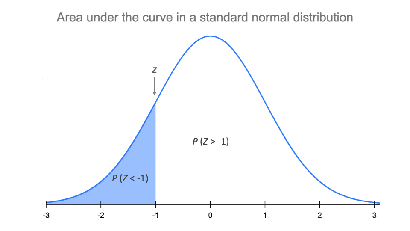

# Roots formatting examples

Five invented root lengths provide small tables for demonstrating document and workbook formatting.

## Workbook

### Sheet: Roots

| Root length (mm) | Squared length (mm^2) |
| --- | --- |
| 12 | |
| 15 | |
| 18 | |
| 20 | |
| 25 | |

- **Region A1:A6:** source
- **Region B1:B6:** calculation

#### At: D1

| Statistic | Value |
| --- | --- |
| Mean (mm) | |
| Example choice | |

- **Region D1:E3:** results

#### At: D8

| Interpretation | Response |
| --- | --- |
| Your explanation | |

- **Region D8:E9:** interpretation

## Tutorial

### Part: Format the document

- **Worksheet:** Roots

#### Step: Organize instructions

1. Read the supplied column headings.
   - The measurements are in column A.
   - Column B is reserved for your calculations.
2. Keep your explanation beside the instruction it supports.

##### Substep: Add a detail

This paragraph belongs to the substep.

##### Explanation: Mark up scientific text

Use **bold** for emphasis, *italics* for a distinction, and `A2` for a literal cell address.
Scientific text can include &alpha;, H0, and mm2.

> A short note appears as a separate block.

#### Step: Show a document table

| Item | Location |
| --- | --- |
| Measurements | A2:A6 |
| Mean | E2 |

#### Step: Include an image

This image comes from the instructor's Microbes z-test tutorial.

#### Step: Link to a section

Return to the [instruction example](#step-organize-instructions).

### Part: Connect a workbook

- **Worksheet:** Roots

#### Step: Enter a formula

1. In cell E2, enter [`=AVERAGE(A2:A6)`](enter:E2).

#### Step: Fill a column

1. In cell B2, enter [`=A2^2`](enter:B2).
2. [Fill B2:B6](fill:B2:B6) down.

#### Step: Select a range

1. [Select A1:B6](select:A1:B6).
2. Choose **Insert > Chart** in your spreadsheet application.

The instruction appears in the document; the reader creates the chart.

#### Step: Replace a supplied value

1. In cell A2, replace the supplied value with [14](replace:A2).

### Part: Offer alternatives

- **Worksheet:** Roots

#### Step: Provide a choice

Choose one of these demonstration formulas for E3.

- **Alternative: Minimum**
  - In cell E3, enter [`=MIN(A2:A6)`](enter:E3).
- **Alternative: Maximum**
  - In cell E3, enter [`=MAX(A2:A6)`](enter:E3).
