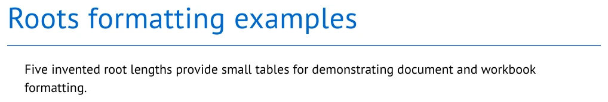
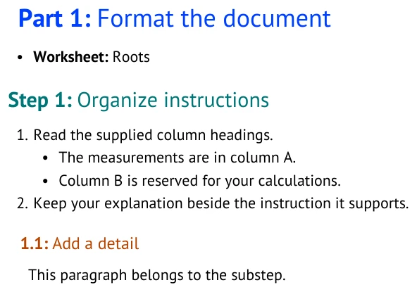
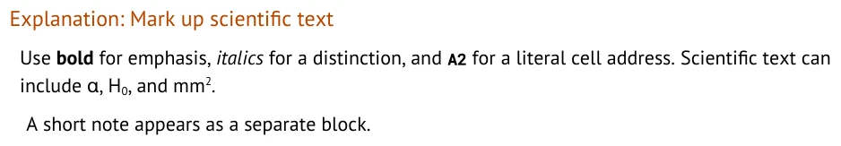
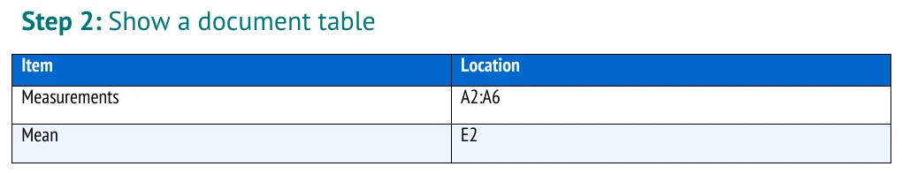
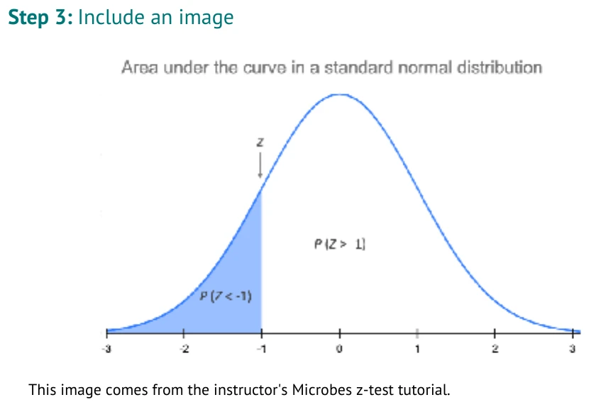
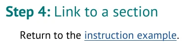

# Format a tutorial document

**Learning goal:** Write Markdown that the compiler turns into a readable tutorial document.

You have already used biostatistics tutorials. This guide shows how to write and format your own.
Choose the biology, question, data, and teaching approach. The compiler handles shared document
style and checks source structure.

The Markdown fragments show the source used for each screenshot. Outlines with placeholders
are labeled separately. The screenshots show output from
[authoring_features.md](../examples/authoring_features.md). The Roots values are only a small,
neutral formatting example. They are not a lesson you must reproduce.

[AUTHORING_GUIDE.md](../AUTHORING_GUIDE.md) | Next: [PART_2_STATISTICS.md](PART_2_STATISTICS.md)

### Part 1: Format the document

#### Step: Create a visible structure

The title and opening paragraph are ordinary authored text at the start of the file:

```markdown
# Roots formatting examples

Five invented root lengths provide small tables for demonstrating document and workbook formatting.
```



Start your file with a `#` title. Under `## Tutorial`, use Parts and Steps as shown here.
The compiler numbers them in the finished document. Use a Substep when a Step needs a smaller task.

```markdown
### Part: Format the document

- **Worksheet:** Roots

#### Step: Organize instructions

1. Read the supplied column headings.
   - The measurements are in column A.
   - Column B is reserved for your calculations.
2. Keep your explanation beside the instruction it supports.

##### Substep: Add a detail

This paragraph belongs to the substep.
```

<!-- screenshots:begin (managed by screenshot-docs) -->

<!-- screenshots:end -->

The headings tell the compiler what each section does. `- **Worksheet:**` selects the workbook tab
for the Part. Use the exact sheet name from your Workbook section.

#### Step: Put your content in the structure

The following outline is explanatory notation, not runnable compiler syntax. Replace every
angle-bracketed placeholder with your own writing before building a tutorial.

```markdown
### Part: <lesson stage>

- **Worksheet:** <worksheet name>

#### Step: <student task>

<setup paragraph>

1. <instruction for your reader>
2. <next instruction>

##### Explanation: <why this task matters>

<explanation in your own words>
```

Your scenario, research question, data, and interpretation are yours. The compiler cannot decide
whether a question is interesting or whether an explanation is scientifically sound.

#### Step: Mark up ordinary prose

Markdown distinguishes an important phrase, literal spreadsheet text, and scientific notation
without asking you to choose fonts or colors.

```markdown
##### Explanation: Mark up scientific text

Use **bold** for emphasis, *italics* for a distinction, and `A2` for a literal cell address.
Scientific text can include &alpha;, H<sub>0</sub>, and mm<sup>2</sup>.

> A short note appears as a separate block.
```

<!-- screenshots:begin (managed by screenshot-docs) -->

<!-- screenshots:end -->

Keep source ASCII: use straight quotes and ordinary hyphens. Use named entities such as `&alpha;`
for scientific symbols. A backtick makes literal text; it does not make a formula calculate.

#### Step: Add a document table

A table under `## Tutorial` belongs in the Word document. It is useful for a comparison, a compact
decision aid, or a list of values a reader should consult.

```markdown
#### Step: Show a document table

| Item | Location |
| --- | --- |
| Measurements | A2:A6 |
| Mean | E2 |
```

<!-- screenshots:begin (managed by screenshot-docs) -->

<!-- screenshots:end -->

The same pipe-table syntax under `## Workbook` creates spreadsheet cells instead. Part 2 shows that
separate use.

#### Step: Include images and links

Use an image when it helps a reader understand your own lesson. Write alternative text that says
what the reader should learn from the image.

```markdown
#### Step: Include an image


This image comes from the instructor's Microbes z-test tutorial.

#### Step: Link to a section

Return to the [instruction example](#step-organize-instructions).
```

<!-- screenshots:begin (managed by screenshot-docs) -->

<!-- screenshots:end -->

<!-- screenshots:begin (managed by screenshot-docs) -->

<!-- screenshots:end -->

This image path is relative to the complete example in `docs/examples/`. Adjust it for your own
source file's location. A link target can be a web address, a
nearby file, or a heading in the same document. See [MARKDOWN.md](../reference/MARKDOWN.md) for the
full set of document patterns.

Use [authoring_features.md](../examples/authoring_features.md) when you want one complete runnable
source that produces these examples. Continue to [PART_2_STATISTICS.md](PART_2_STATISTICS.md) to
define what appears in the reader's starter workbook.
