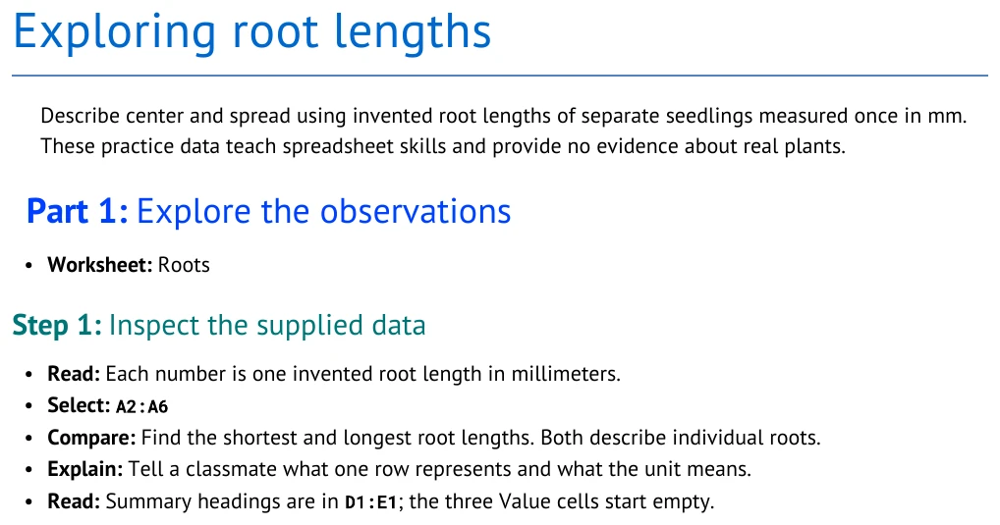
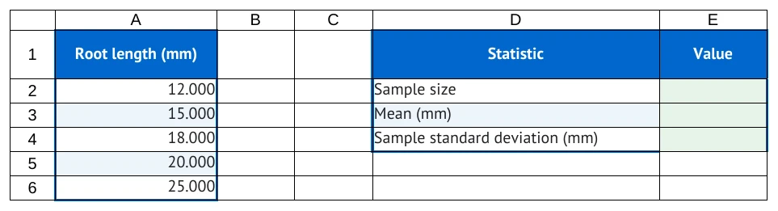
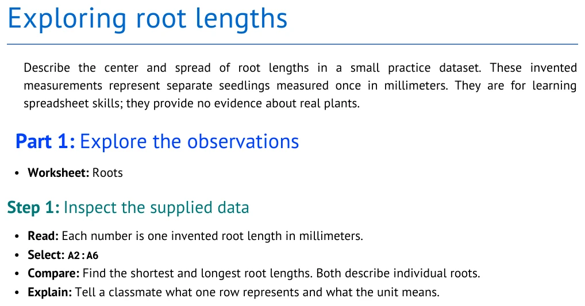

# Make a Roots tutorial

Start with a small biology lesson: five synthetic root lengths, measured in millimeters.
You will write its instructions in Markdown and design a workbook with space for the answers.
Keep editing one file, `my_roots_tutorial.md`, throughout all three Parts.

[STUDENT_GUIDE.md](../STUDENT_GUIDE.md) | Next: [PART_2_STATISTICS.md](PART_2_STATISTICS.md)

## Workbook

### Sheet: Roots

| Root length (mm) |
| --- |
| 12 |
| 15 |
| 18 |
| 20 |
| 25 |

- **Region A1:A6:** source

#### At: D1

| Statistic | Value |
| --- | --- |
| Sample size | |
| Mean (mm) | |
| Sample standard deviation (mm) | |

- **Region D1:E4:** results

## Tutorial

### Part 1: Create your tutorial

- **Worksheet:** Roots

#### Step: Meet the finished lesson

Title excerpt from [root_05_variation.md](../examples/authoring_course/root_05_variation.md),
the completed first lesson shown below:

```markdown
# Exploring root lengths
```

<!-- screenshots:begin (managed by screenshot-docs) -->

<!-- screenshots:end -->

This is the **generated document** your reader follows. The compiler gives your headings,
lists, and formulas a consistent appearance. You supply the words and the spreadsheet design.
This partial preview shows the opening; open the complete
[root_statistics.pdf](../examples/authoring_course/published/root_statistics.pdf) for every Step.

<!-- screenshots:begin (managed by screenshot-docs) -->

<!-- screenshots:end -->

This is the **supplied starter workbook**. The labels are ready; the reader calculates the
blank values. A completed demonstration later shows the answers for comparison.
The observations are invented practice data, not measurements from an experiment.

Columns run vertically and use letters; rows run horizontally and use numbers.
A cell is their intersection: `E3` means column E, row 3. A colon joins the first and last
cells of a range: `A2:A6` includes A2, A3, A4, A5, and A6, all in column A.
In the picture, the measurements occupy column A and the blank answers occupy column E.

##### Substep: Try tracing one result

1. Find the supplied label **Mean (mm)** in the worksheet picture.
2. Identify the blank cell beside it. Which cells contain the measurements it will use?

##### Substep: Check your answer

The destination is E3. Its inputs are `A2:A6`. The heading in `A1` is text, not a measurement.
You will connect this input range to its destination in Part 2.

##### Substep: Open your working source

1. Open [root_01_meet.md](../examples/authoring_course/root_01_meet.md).
2. On GitHub, choose **Raw** to see the actual source. Copy the source text into a plain-text editor.
   Copying a rendered page can lose the punctuation that makes Markdown work.
3. Save it as `my_roots_tutorial.md`. Confirm that the name ends in `.md`, not `.md.txt`.
   Use plain text rather than a Word document or rich-text file.
4. Keep this file open. Each checkpoint is a comparison copy; your work stays in the same file.

#### Step: Write plain Markdown

Tutorial excerpt from [root_02_write.md](../examples/authoring_course/root_02_write.md).
The output also shows its title and introductory explanation.

```markdown
### Part: Explore the observations

- **Worksheet:** Roots

#### Step: Inspect the supplied data

- **Read:** Each number is one invented root length in millimeters.
- **Select:** `A2:A6`
- **Compare:** Find the shortest and longest root lengths. Both describe individual roots.
- **Explain:** Tell a classmate what one row represents and what the unit means.
```

<!-- screenshots:begin (managed by screenshot-docs) -->

<!-- screenshots:end -->

Notice the visible hierarchy. A Part groups Steps; a Step can contain smaller Substeps.
The compiler supplies the Step numbers. A long Step can continue onto another page.
The marks in the source tell the compiler what each piece means:

| Source mark | Meaning |
| --- | --- |
| `# Title` | Document title; one `#` followed by a space |
| `### Part: Explore the observations` | A Part; numbering is automatic |
| `#### Step: Inspect the supplied data` | A Step; numbering is automatic |
| `##### Substep: Read the heading` | A smaller task inside a Step |
| `**important**` | Bold text; two asterisks on each side |
| `` `A2:A6` `` | Literal text; a backtick on each side |
| `1. Read the heading.` | An item in an ordered list |

A backtick is the keyboard mark often on the same key as `~`; it is not an apostrophe.
Keep paired marks on both sides of the words. Put a blank line before a list or heading.
Use straight keyboard quotes and ordinary hyphens in your source.

##### Substep: Try a small edit

1. In `my_roots_tutorial.md`, change the document title to `# My root-length investigation`.
2. Add a sentence explaining that the data are synthetic.
3. Add a two-item numbered list asking readers to identify the units and count the observations.
4. Put `**` around the word you want to emphasize. Save the source.

##### Substep: Check your answer

Your source might contain `**millimeters**`. The output shows **millimeters** in bold and keeps
the two list items together. One unmatched `**` can leave punctuation visible instead of bold text.
These are your own wording exercises; the checkpoint picture shows its original bullets.
Compare the structure with [root_02_write.md](../examples/authoring_course/root_02_write.md).
Your own title and sentence can differ.

#### Step: Design the worksheet

Workbook excerpt from [root_03_layout.md](../examples/authoring_course/root_03_layout.md):

```markdown
## Workbook

### Sheet: Roots

| Root length (mm) |
| --- |
| 12 |
| 15 |
| 18 |
| 20 |
| 25 |

#### At: D1

| Statistic | Value |
| --- | --- |
| Sample size | |
| Mean (mm) | |
| Sample standard deviation (mm) | |
```

<!-- screenshots:begin (managed by screenshot-docs) -->

<!-- screenshots:end -->

<!-- screenshots:begin (managed by screenshot-docs) -->

<!-- screenshots:end -->

The first table starts at `A1`. Its header becomes spreadsheet row 1. The separator `| --- |`
helps Markdown recognize the table; **it does not become a spreadsheet row**.
The second table starts at `D1` because you place `#### At: D1` immediately before it.
Every pipe separates cells; an empty space between two pipes leaves a cell blank.

| Spreadsheet location | Supplied content |
| --- | --- |
| A1 | Root length (mm) |
| A2:A6 | The five measurements |
| D1:E1 | Statistic and Value |
| D2:D4 | Sample size, Mean (mm), Sample standard deviation (mm) |
| E2:E4 | Blank spaces for the reader's results |

##### Substep: Try designing the blanks

1. In your existing `## Workbook` section, add `#### At: D1` and the summary table shown above
   after the measurements and before `## Tutorial`. Keep one Workbook section and one
   `### Sheet: Roots` heading; add the second table within that sheet.
2. Predict where the last observation, `25`, appears. Then find it in the starter picture.
3. Leave the summary values empty. You will write instructions that tell the reader how to fill them.

##### Substep: Check your answer

The last observation is `A6`. Writing `18` beside **Mean (mm)** in the Workbook table would
supply the answer in E3. Keep that cell empty so calculating the mean remains the reader's task.
An empty cell differs from `0`, which is a supplied numeric value.

Numbers normally display three decimal places: `12` appears as `12.000`.
This changes the display, not the stored precision. It does not calculate answers.
Compare your completed layout with [root_03_layout.md](../examples/authoring_course/root_03_layout.md).

You now have a source file with a readable opening and a labeled student worksheet.
Continue in [PART_2_STATISTICS.md](PART_2_STATISTICS.md) to connect the blanks to calculations.

[STUDENT_GUIDE.md](../STUDENT_GUIDE.md) | Next: [PART_2_STATISTICS.md](PART_2_STATISTICS.md)
