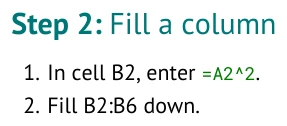

# Construct a starter workbook

**Learning goal:** Define a clear starting workbook and connect its blank work to visible tutorial
instructions.

The Workbook section supplies what readers receive. The Tutorial section tells them what to do.
You decide the labels, data, calculations, and response space that serve your original lesson.

[AUTHORING_GUIDE.md](../AUTHORING_GUIDE.md) | Previous: [PART_1_CREATE.md](PART_1_CREATE.md)
| Next: [PART_3_IMPROVE.md](PART_3_IMPROVE.md)

### Part 2: Construct a workbook

#### Step: Supply a worksheet

Start `## Workbook` with a sheet name and a rectangular table. The table heading and every supplied
value become cells in the Excel workbook.

```markdown
## Workbook

### Sheet: Roots

| Root length (mm) | Squared length (mm^2) |
| --- | --- |
| 12 | |
| 15 | |
| 18 | |
| 20 | |
| 25 | |

- **Region A1:A6:** source
- **Region B1:B6:** calculation
```

<!-- screenshots:begin (managed by screenshot-docs) -->

<!-- screenshots:end -->

The full workbook crop also shows the result table defined in the next section.
The header row is real spreadsheet content. The Markdown separator row is not. Empty cells remain
blank for student work; `0` would supply a value. Regions tell the compiler how to present an area,
but they do not create labels or formulas.

Use a meaningful worksheet name and headings from the beginning. Students should be able to tell
what each table and blank area is for when they open the workbook.

#### Step: Place a second table

Use `#### At:` to place the next workbook table at a specific upper-left cell. This is useful for a
result summary or a comparison beside the supplied data.

```markdown
#### At: D1

| Statistic | Value |
| --- | --- |
| Mean (mm) | |
| Example choice | |

- **Region D1:E3:** results
```

<!-- screenshots:begin (managed by screenshot-docs) -->

<!-- screenshots:end -->

Workbook tables are the reader's starting state. If a reader should enter a formula, leave that
cell blank here. Do not supply a formula and then ask the reader to enter it again.

#### Step: Reserve response space

An interpretation area makes room for a reader's own explanation. Its wording belongs to your
lesson, not to the compiler.

```markdown
#### At: D8

| Interpretation | Response |
| --- | --- |
| Your explanation | |

- **Region D8:E9:** interpretation
```

<!-- screenshots:begin (managed by screenshot-docs) -->

<!-- screenshots:end -->

The `interpretation` region styles the area. It does not write a research question or decide what a
good response says. Supply prompt text that fits your own scenario.

#### Step: Connect an instruction to a blank cell

Semantic links keep the words a student sees and the compiler's cell target together. The target
inside the parentheses is hidden in the generated document.

```markdown
1. In cell E2, enter [`=AVERAGE(A2:A6)`](enter:E2).
```

<!-- screenshots:begin (managed by screenshot-docs) -->

<!-- screenshots:end -->

The visible instruction and `enter:E2` must agree. The formula's input range, `A2:A6`, is not its
destination. The compiler checks supported references and assignment conflicts; it does not decide
whether this is the right formula for your scientific question.

#### Step: Use a repeated calculation

Enter one formula, then use `fill:` to identify the range the reader fills down. The first cell of
the fill range must already receive a formula.

```markdown
1. In cell B2, enter [`=A2^2`](enter:B2).
2. [Fill B2:B6](fill:B2:B6) down.
```

<!-- screenshots:begin (managed by screenshot-docs) -->

<!-- screenshots:end -->

`Fill` records a student action. The generated starter keeps B2:B6 blank. Formula references shift
according to ordinary spreadsheet rules when the student fills down.

#### Step: Record selections and intentional changes

Use `select:` for a range a reader needs to highlight. Use `replace:` only when an activity
deliberately changes a supplied value.

```markdown
#### Step: Select a range

1. [Select A1:B6](select:A1:B6).
2. Choose **Insert > Chart** in your spreadsheet application.

The instruction appears in the document; the reader creates the chart.

#### Step: Replace a supplied value

1. In cell A2, replace the supplied value with [14](replace:A2).
```

<!-- screenshots:begin (managed by screenshot-docs) -->

<!-- screenshots:end -->

<!-- screenshots:begin (managed by screenshot-docs) -->

<!-- screenshots:end -->

Use `label:` only if entering a label is part of the reader's task. Normally, supply worksheet
labels in Workbook tables. See [ACTIONS.md](../reference/ACTIONS.md) for every action and
[WORKSHEETS.md](../reference/WORKSHEETS.md) for cell types, regions, and placement.

#### Step: Leave room for your lesson

This outline is instructional notation, not runnable compiler syntax. Replace its placeholders
with your own content before building.

```text
## Workbook

### Sheet: <worksheet name>

| <data heading> | <calculation heading> |
| --- | --- |
| <supplied value> | |

#### At: <summary location>

| <result label> | <value> |
| --- | --- |
| <your label> | |

## Tutorial

### Part: <your lesson stage>

- **Worksheet:** <worksheet name>

#### Step: <your student task>

<research question or instruction>
```

Continue to [PART_3_IMPROVE.md](PART_3_IMPROVE.md) for the normal build, inspection, and revision
cycle.
