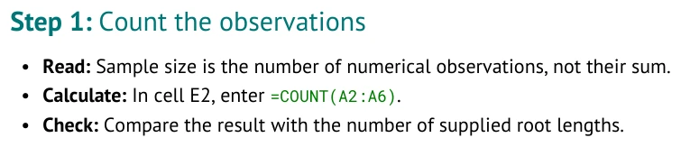
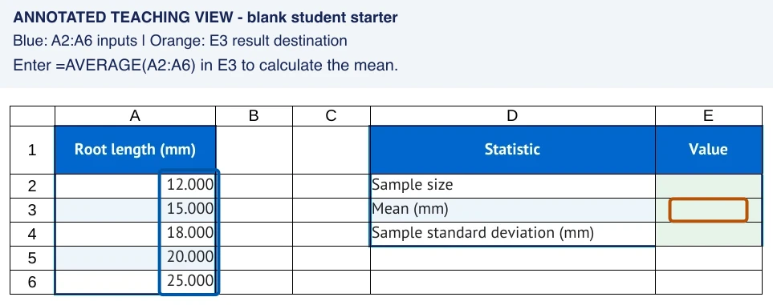
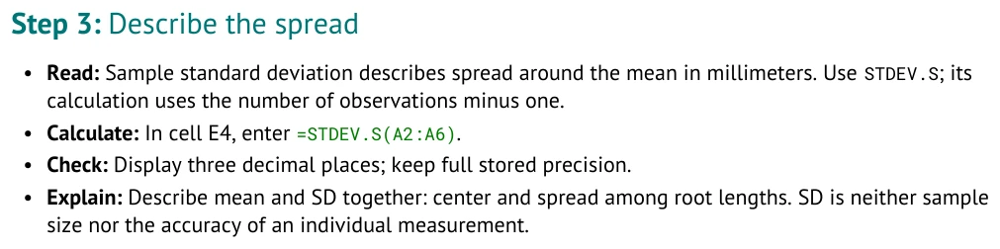
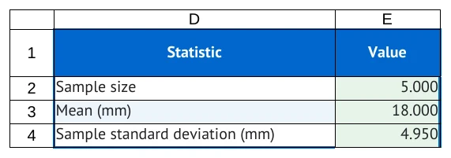

# Give the Roots lesson calculations

Continue editing `my_roots_tutorial.md`. Your reader will count the measurements, calculate
their mean, and describe their spread. Finish this Part to complete your first tutorial.
Part 3 is an optional extension.

[STUDENT_GUIDE.md](../STUDENT_GUIDE.md) | Previous: [PART_1_CREATE.md](PART_1_CREATE.md)
| Next: [PART_3_IMPROVE.md](PART_3_IMPROVE.md)

## Workbook

### Sheet: Roots

| Root length (mm) |
| --- |
| 12 |
| 15 |
| 18 |
| 20 |
| 25 |

- **Region A1:A6:** source

#### At: D1

| Statistic | Value |
| --- | --- |
| Sample size | |
| Mean (mm) | |
| Sample standard deviation (mm) | |

- **Region D1:E4:** results

## Tutorial

### Part 2: Complete the statistics lesson

- **Worksheet:** Roots

#### Step: Count the measurements

Excerpt from [root_04_calculate.md](../examples/authoring_course/root_04_calculate.md).
The document picture shows this count Step.

```markdown
### Part: Summarize root lengths

- **Worksheet:** Roots

#### Step: Count the observations

- **Read:** Sample size is the number of numerical observations, not their sum.
- **Calculate:** In cell E2, enter [`=COUNT(A2:A6)`](enter:E2).
- **Check:** Compare the result with the number of supplied root lengths.
```

<!-- screenshots:begin (managed by screenshot-docs) -->

<!-- screenshots:end -->

The formula **reads** `A2:A6` and the instruction **writes** to E2.
The colon means the whole range, including both endpoints. `COUNT` counts numeric entries.
It does not sum their lengths.

The square brackets hold the visible text, and the parentheses hold its action target.
Keep both pairs closed. Backticks inside the brackets preserve the exact formula.
The reader sees a formula; `enter:E2` connects it to the workbook destination.

##### Substep: Try adding the count

1. Add the fenced example's contents at the end of your source's `## Tutorial` section.
   This creates a second Part after the opening observation Steps.
   Copy the Markdown inside the fence, leaving out the three-backtick fence lines themselves.
2. Keep `- **Worksheet:** Roots` under the Part heading so the actions have a worksheet.
3. Save your file. Compare with [root_04_calculate.md](../examples/authoring_course/root_04_calculate.md),
   which also includes the mean you will add next.

##### Substep: Check your answer

E2 and `enter:E2` must name the same destination. If the sentence says E2 but the target says
`enter:E3`, the instruction points at the mean's cell. Correct both pieces to agree with the layout.
In the spreadsheet, start formulas with `=`. Without it, `COUNT(A2:A6)` is text and gives no count.

#### Step: Find the mean

The next Step in the same checkpoint:

```markdown
#### Step: Calculate the mean

- **Read:** The arithmetic mean adds the root lengths and divides by the sample size.
- **Calculate:** In cell E3, enter [`=AVERAGE(A2:A6)`](enter:E3).
- **Explain:** The mean describes the center of these observations in millimeters.
```

<!-- screenshots:begin (managed by screenshot-docs) -->

<!-- screenshots:end -->

<!-- screenshots:begin (managed by screenshot-docs) -->

<!-- screenshots:end -->

The formula reads the five measurements in A2:A6 and places their mean in E3.

The mean is the sum of the lengths divided by their count. Here, `90 / 5 = 18` mm.
The input range stays `A2:A6`; the destination changes to E3.
A spreadsheet function saves you from typing the arithmetic for each new data set.

##### Substep: Try explaining the result

1. Add the mean Step to your source. Keep the formula link inside its Calculate bullet.
2. Add a question asking the reader to compare the mean with the smallest and largest measurements.
3. Predict whether the mean must equal one of the observed lengths.

##### Substep: Check your answer

The mean is `18.000` mm, between `12.000` and `25.000` mm. It happens to equal an observation here;
a mean need not equal any individual observation. Keep your explanation tied to this small data set.

#### Step: Describe the variation

Final Step excerpt from [root_05_variation.md](../examples/authoring_course/root_05_variation.md):

```markdown
#### Step: Describe the spread

- **Read:** Sample standard deviation describes spread around the mean in millimeters.
  Use `STDEV.S`; its calculation uses the number of observations minus one.
- **Calculate:** In cell E4, enter [`=STDEV.S(A2:A6)`](enter:E4).
- **Check:** Display three decimal places; keep full stored precision.
- **Explain:** Describe mean and SD together: center and spread among root lengths.
  SD is neither sample size nor the accuracy of an individual measurement.
```

<!-- screenshots:begin (managed by screenshot-docs) -->

<!-- screenshots:end -->

The mean describes the center. Sample standard deviation describes how spread out the
measurements are around that center. `STDEV.S` treats these observations as a sample.
Its result uses the same units as the observations: millimeters.

<!-- screenshots:begin (managed by screenshot-docs) -->

<!-- screenshots:end -->

This is a **completed demonstration**, not the supplied starter.
The sample SD is about `4.949747468`, displayed as `4.950` mm.
The three-decimal display keeps more precision in the stored result than you see on the screen.
It is not a statement about the precision of these invented measurements.

##### Substep: Try completing the source

1. Add the variation Step after the mean Step in `my_roots_tutorial.md`.
2. Add a question: "Could two groups have the same mean but different spreads?"
3. Compare your source with [root_05_variation.md](../examples/authoring_course/root_05_variation.md).
   This checkpoint is a complete first tutorial.

##### Substep: Check your answer

Yes. For example, `17, 18, 19` and `12, 18, 24` both have mean `18`, but the second group is
more spread out. Standard deviation is a spread, not another mean and not a standard error.
Your Roots summary should ask for `STDEV.S`, with its period and sample suffix intact.

#### Step: Build and check

Complete the setup in [INSTALL.md](../INSTALL.md) before running the compiler; see
[USAGE.md](../USAGE.md) for the build workflow. A terminal is an application where you type
commands. Open one in the downloaded `markdown-to-tutorial` project folder, which contains
`source_me.sh` and `make_tutorial.py`. Save `my_roots_tutorial.md` there for the commands below,
or replace its name with the path to your saved source.

```bash
source source_me.sh && python3 make_tutorial.py lint my_roots_tutorial.md
source source_me.sh && python3 make_tutorial.py build my_roots_tutorial.md
```

<!-- screenshots:begin (managed by screenshot-docs) -->

<!-- screenshots:end -->

`lint` checks the source and reports locations to inspect. `build` produces the document and workbook.
The picture shows completed results for comparison; the build creates a blank starter.

The default bundle is `tutorial_output/my_roots_tutorial/`. Open the `.docx` to inspect the
editable document, the `.pdf` to check page layout, and the `.xlsx` to check the starting worksheet.
A build does not perform your reader's calculations. The starter's summary values should be blank.

##### Substep: Try the reader's calculations

Use a copy of the generated workbook, or the practice workbook supplied with this Part.
These are actual practice actions; the fenced examples above are source to edit.

1. In cell E2, enter:
   [`=COUNT(A2:A6)`](enter:E2)
2. In cell E3, enter:
   [`=AVERAGE(A2:A6)`](enter:E3)
3. In cell E4, enter:
   [`=STDEV.S(A2:A6)`](enter:E4)
4. Compare your results with the completed demonstration. Reopen the untouched starter to confirm
   that the answers were not supplied there.

##### Substep: Check your answer

| Result cell | Expected display | Meaning |
| --- | --- | --- |
| E2 | 5.000 | Five numeric observations |
| E3 | 18.000 | Mean root length, in mm |
| E4 | 4.950 | Sample standard deviation, in mm |

If a result differs, compare the exact destination, leading `=`, function name, and range endpoints.
If lint reports a problem, read its actual message and inspect the named source line before rebuilding.
A successful local build checks local files; it does not establish Google Docs or Sheets behavior.

You have completed a tutorial with supplied data, blank result cells, copyable formulas, and checks.
You can share this first version now or extend the same source in
[PART_3_IMPROVE.md](PART_3_IMPROVE.md).

[STUDENT_GUIDE.md](../STUDENT_GUIDE.md) | Previous: [PART_1_CREATE.md](PART_1_CREATE.md)
| Next: [PART_3_IMPROVE.md](PART_3_IMPROVE.md)
