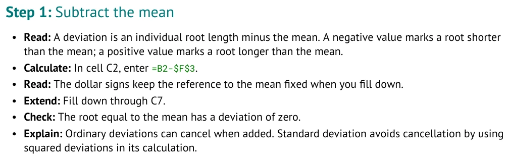
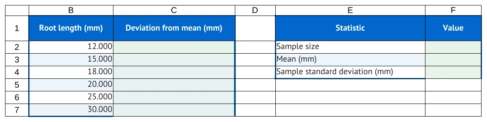

# Grow and share your tutorial

Your first tutorial is complete. These optional extensions help you maintain it as the data
and layout change. Keep working in `my_roots_tutorial.md`; compare checkpoints when needed.
You will build an expanded workbook with six observations and a blank deviation column.

[STUDENT_GUIDE.md](../STUDENT_GUIDE.md) | Previous: [PART_2_STATISTICS.md](PART_2_STATISTICS.md)

Student source for the expanded Roots workbook used in this Part:

```markdown
## Workbook

### Sheet: Roots

| Root length (mm) | Deviation from mean (mm) |
| --- | --- |
| 12 | |
| 15 | |
| 18 | |
| 20 | |
| 25 | |
| 30 | |

- **Region A1:A7:** source
- **Region B1:B7:** calculation

#### At: D1

| Statistic | Value |
| --- | --- |
| Sample size | |
| Mean (mm) | |
| Sample standard deviation (mm) | |

- **Region D1:E4:** results

## Tutorial
```

### Part 3: Improve your tutorial

- **Worksheet:** Roots

#### Step: Grow the data set

Workbook table excerpt from [root_06_grow.md](../examples/authoring_course/root_06_grow.md):

```markdown
| Root length (mm) | Deviation from mean (mm) |
| --- | --- |
| 12 | |
| 15 | |
| 18 | |
| 20 | |
| 25 | |
| 30 | |
```

<!-- screenshots:begin (managed by screenshot-docs) -->

<!-- screenshots:end -->

Add the new observation `30` and a supplied deviation heading to your Workbook table.
Leave the deviation cells blank. A new observation is input; a deviation is work the reader performs.

The data now end at `A7`. Update all three summary formulas in your Tutorial section.
These are separate Calculate-line excerpts from the same checkpoint:

```markdown
- **Calculate:** In cell E2, enter [`=COUNT(A2:A7)`](enter:E2).
```

```markdown
- **Calculate:** In cell E3, enter [`=AVERAGE(A2:A7)`](enter:E3).
```

```markdown
- **Calculate:** In cell E4, enter [`=STDEV.S(A2:A7)`](enter:E4).
```

##### Substep: Try following the new observation

1. Update the table and all three formula ranges in `my_roots_tutorial.md`.
   Change the earlier Select range to `A2:A7` too.
2. Update the lesson's statements about the number of observations and expected results.
3. Predict what happens if you change only the count's endpoint to `A7`.

##### Substep: Check your answer

The count would use six observations, but the mean and SD would still describe the original five.
Each formula can look plausible alone while the summary describes different inputs.
With all six included, expect count `6.000`, mean `20.000` mm, and sample SD `6.603` mm.
Compare the updated summary in [root_06_grow.md](../examples/authoring_course/root_06_grow.md).
Its deviation instructions are the next optional task.

#### Step: Keep the mean fixed

Deviation Part excerpt from the same checkpoint. The output also shows its final checks.

```markdown
### Part: Examine individual deviations

- **Worksheet:** Roots

The practice dataset now includes one additional invented root length of 30 mm.
The summary formulas include all six observations. Calculate the mean before deviations.

#### Step: Subtract the mean

- **Read:** A deviation is an individual root length minus the mean. A negative value
  marks a root shorter than the mean; a positive value marks a root longer than the mean.
- **Calculate:** In cell B2, enter [`=A2-$E$3`](enter:B2).
- **Read:** The dollar signs keep the reference to the mean fixed when you fill down.
- **Extend:** [Fill down through B7](fill:B2:B7).
```

<!-- screenshots:begin (managed by screenshot-docs) -->

<!-- screenshots:end -->

A deviation is one measurement minus the mean. Here `A2` selects the first measurement,
and $E$3 selects the calculated mean. When you fill down, `A2` changes to `A3`, then `A4`.
The dollar signs keep both the mean's column and row fixed during filling.
They do not prevent the workbook layout from being changed later.

<!-- screenshots:begin (managed by screenshot-docs) -->

<!-- screenshots:end -->

This is a **completed demonstration**. The supplied starter keeps these calculation cells blank.
Negative deviations mark roots below the mean; positive deviations mark roots above it.

##### Substep: Try the expanded practice workbook

First add the deviation Part shown above to your own source after its summary calculations.
Rebuild the grown `my_roots_tutorial.md` using the build command from Part 2. Open a **copy** of
`tutorial_output/my_roots_tutorial/my_roots_tutorial.xlsx`; confirm that it has six measurements
and a blank deviation column before starting. The GitHub page does not supply a separate
expanded practice download. If you are using a compiled course bundle instead, you may use
a copy of this Part's accompanying workbook, which has the same A/B layout.
Calculate the new mean before the deviations.

1. In cell E2, enter [`=COUNT(A2:A7)`](enter:E2).
2. In cell E3, enter [`=AVERAGE(A2:A7)`](enter:E3).
3. In cell E4, enter [`=STDEV.S(A2:A7)`](enter:E4).
4. In cell B2, enter [`=A2-$E$3`](enter:B2), then press Enter to confirm it.
5. Select `B2:B7`, including B2 with its first formula. Use your spreadsheet's **Fill Down**
   command to [fill down through B7](fill:B2:B7).

##### Substep: Check your answer

The first deviation is `12 - 20 = -8` mm. The last is `30 - 20 = 10` mm.
At row 3 the formula is `=A3-$E$3`; the mean stays fixed.
If you use `=A2-E3`, filling down changes the mean reference to `E4`, then E5, and so on.
Restore `$E$3` in the first formula and fill again.

If you stop filling at `B6`, the new observation has no deviation. Match the fill endpoint `B7`
to the data endpoint `A7`. Check the last row, not just the first correctly calculated cell.

#### Step: Move the connections

Table-location excerpts from [root_07_move.md](../examples/authoring_course/root_07_move.md).
Keep the existing table rows beneath each heading.

```markdown
#### At: B1

| Root length (mm) | Deviation from mean (mm) |
```

```markdown
#### At: E1

| Statistic | Value |
```

<!-- screenshots:begin (managed by screenshot-docs) -->

<!-- screenshots:end -->

<!-- screenshots:begin (managed by screenshot-docs) -->

<!-- screenshots:end -->

Now imagine inserting an empty column before column A. Every existing column moves one place right.
You must move the data table, summary table, action destinations, and formula references together.
The pictures show the moved example; **this Part's practice workbook still uses the earlier A/B layout**.

| Connection | Before the move | After the move |
| --- | --- | --- |
| Measurements | A2:A7 | B2:B7 |
| Deviation destination | B2:B7 | C2:C7 |
| Summary values | E2:E4 | F2:F4 |
| Mean reference | $E$3 | $F$3 |

The moved deviation Step begins as follows; the document picture above shows this Step:

```markdown
#### Step: Subtract the mean

- **Read:** A deviation is an individual root length minus the mean. A negative value
  marks a root shorter than the mean; a positive value marks a root longer than the mean.
- **Calculate:** In cell C2, enter [`=B2-$F$3`](enter:C2).
- **Read:** The dollar signs keep the reference to the mean fixed when you fill down.
- **Extend:** [Fill down through C7](fill:C2:C7).
```

##### Substep: Try a coordinated preview

1. Save your source. Preview the column insertion from the project folder:

   ```bash
   source source_me.sh && python3 make_tutorial.py worksheet-edit my_roots_tutorial.md --sheet Roots insert-columns --at A --count 1
   ```

2. Read the proposed changes and any review messages. This first command leaves your file unchanged.
3. If the preview matches the move above, run the same command with `--write` appended.
4. Compare the changed source with [root_07_move.md](../examples/authoring_course/root_07_move.md).
   Check your ordinary explanation sentences too; a coordinate edit cannot decide what your prose means.

##### Substep: Check your answer

The mean formula is now `=AVERAGE(B2:B7)` entered in F3.
The deviation formula reads B2 and $F$3 and writes to C2.
Changing only the table's location would leave the instructions connected to the old layout.
Dollar signs preserve a reference during filling; this coordinated layout edit moves that reference.

#### Step: Check and share

Final Step excerpt from [root_08_share.md](../examples/authoring_course/root_08_share.md).
The workbook picture below shows its expected results after the reader finishes.

```markdown
#### Step: Compare results and meaning

- **Check:** After completing the instructions, your classmate should obtain sample size 6,
  mean 20.000 mm, and sample standard deviation 6.603 mm.
- **Check:** The first deviation should be -8.000 mm and the last should be 10.000 mm.
- **Explain:** Ask your classmate what a negative deviation means and whether the standard
  deviation measures spread among roots or the accuracy of the ruler.
- **Revise:** Improve any unclear wording in the Markdown source, then rebuild both files.
  Keep the measurements described as invented; this exercise supports no biological claim.
```

<!-- screenshots:begin (managed by screenshot-docs) -->

<!-- screenshots:end -->

Use the picture as a **completed demonstration**, not as the file you give a reader to complete.
Keep the lesson text, data, and instructions in your Markdown source.
The DOCX, PDF, and XLSX are generated copies. Editing one of those copies does not update the source.

##### Substep: Try a reader handoff

1. Add a final interpretation question. Compare with
   [root_08_share.md](../examples/authoring_course/root_08_share.md).
2. Run lint, then rebuild your saved source as in Part 2.
3. Open the PDF. Check that each destination and formula is readable and that images are not clipped.
4. Open the XLSX. Confirm that supplied labels are present and calculation cells start blank.
5. On a disposable workbook copy, follow the instructions through the last row.
6. Optionally, give a classmate the PDF or DOCX together with the blank XLSX. Ask them to find
   the first task and explain one result. Keep your Markdown source for future edits.

##### Substep: Check your answer

The moved summary should show `6.000`, `20.000`, and `6.603` in F2:F4 after the reader works.
The last deviation, in C7, should display `10.000` mm.
If you import into Google Docs or Sheets, inspect the imported files and try the calculations there;
a successful local build does not verify the imported version.

Maintainers can refresh these illustrations with the one-command workflow in
[USAGE.md](../USAGE.md#refresh-documentation-screenshots).

Return to [STUDENT_GUIDE.md](../STUDENT_GUIDE.md) for checkpoints and focused reference pages.

[STUDENT_GUIDE.md](../STUDENT_GUIDE.md) | Previous: [PART_2_STATISTICS.md](PART_2_STATISTICS.md)
