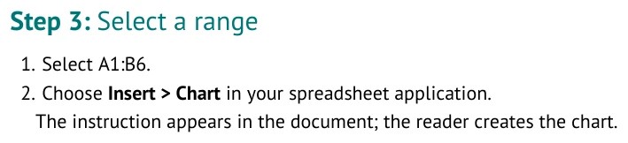
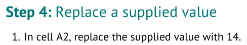
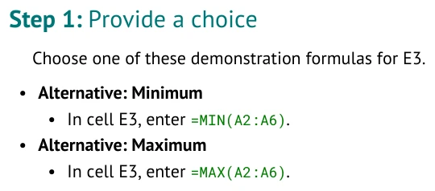

# Connect instructions to cells

Use an action link when an instruction asks a reader to affect a known cell or range. It keeps the
visible wording and machine-readable target in one place.

Return to [../AUTHORING_GUIDE.md](../AUTHORING_GUIDE.md) or
[../FORMATTING_GUIDE.md](../FORMATTING_GUIDE.md).

## Select a range

Type this Markdown:

```markdown
#### Step: Select a range

1. [Select A1:B6](select:A1:B6).
2. Choose **Insert > Chart** in your spreadsheet application.

The instruction appears in the document; the reader creates the chart.
```

<!-- screenshots:begin (managed by screenshot-docs) -->

<!-- screenshots:end -->

The linked words appear in the document. The target tells the compiler which range the words mean.
Selection does not change the starter workbook.

## Enter, fill, label, and replace

| Task | Markdown destination | Starting cell |
| --- | --- | --- |
| Reader enters a value or formula | `enter:E2` | Blank |
| Reader copies a first-row formula | `fill:B2:B6` | Blank work cells |
| Reader creates a label | `label:B1` | Blank |
| Reader changes supplied content | `replace:A2` | Already populated |
| Reader selects cells | `select:A1:B6` | Unchanged |

Visible prose must name the destination or make it unmistakable. Keep the visible address and
action target identical in an explicit clause such as `In cell E2, enter ...`.

## Replace supplied content

Type this Markdown:

```markdown
#### Step: Replace a supplied value

1. In cell A2, replace the supplied value with [14](replace:A2).
```

<!-- screenshots:begin (managed by screenshot-docs) -->

<!-- screenshots:end -->

Use `replace:` only when changing a prior value is part of the lesson. Use `enter:` for an empty
cell. The compiler reports an error if `enter:` or `label:` writes over supplied content.

## Offer alternatives

Type this Markdown:

```markdown
#### Step: Provide a choice

Choose one of these demonstration formulas for E3.

- **Alternative: Minimum**
  - In cell E3, enter [`=MIN(A2:A6)`](enter:E3).
- **Alternative: Maximum**
  - In cell E3, enter [`=MAX(A2:A6)`](enter:E3).
```

<!-- screenshots:begin (managed by screenshot-docs) -->

<!-- screenshots:end -->

Contiguous sibling Alternative items create one instructional choice. They are not executable
conditional logic. A later instruction can safely use only values available after every choice.

Actions belong inside a Step. For legacy bold action syntax, cross-sheet references, and validation
rules, see [../TUTORIAL_SPEC.md](../TUTORIAL_SPEC.md).

## Supply labels or teach label entry

Normally, supply labels in Workbook tables. If entering a label is itself a learner task, use a
Label action with an initially blank destination. For example, F1 is blank in the feature demo:

```markdown
1. In cell F1, type [Result](label:F1).
```

The linked words become the label. F1 remains blank in the generated starter. Do not seed the same
label in Workbook and ask the learner to enter it again.

## Recognize older action syntax

Some instructor sources use a bold action opening. These two fragments express the same entry;
use one, not both, in a tutorial:

```markdown
1. In cell E2, enter [`=AVERAGE(A2:A6)`](enter:E2).
```

```markdown
1. **Enter E2:** `=AVERAGE(A2:A6)`
```

Ordinary instructions do not need bold action labels. The link form lets you keep your wording.
A legacy menu instruction such as `- **Choose:** Insert > Chart` receives menu-path styling;
it describes what the reader clicks rather than creating the chart.
