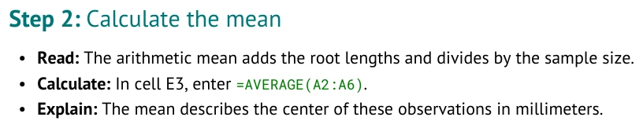
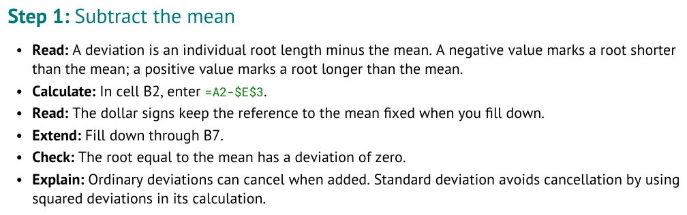

# Connect instructions to cells

Use this page when a student needs to enter, fill, select, or replace spreadsheet content.
An action joins visible instructions to a specific cell or range on the current worksheet.

Start the course at [../STUDENT_GUIDE.md](../STUDENT_GUIDE.md), or use the topic index in
[../FORMATTING_GUIDE.md](../FORMATTING_GUIDE.md).

## Read both parts

```markdown
1. In cell E3, enter:
   [`=AVERAGE(A2:A6)`](enter:E3)
```

| Source part | Purpose |
| --- | --- |
| `In cell E3` | Tells the student where to work |
| `` `=AVERAGE(A2:A6)` `` | Shows exactly what to enter |
| `enter:E3` | Records the destination for compiler checks |

The formula's input range is A2:A6. Its destination is E3. These addresses have different jobs.
A heading such as Mean does not connect them automatically.

<!-- screenshots:begin (managed by screenshot-docs) -->

<!-- screenshots:end -->

Notice that the printed instruction includes E3, while the hidden action destination does not
appear as a separate link address. Keep visible wording and the hidden destination consistent.

## Set the worksheet

Put actions inside a Step in a Part that selects the worksheet:

```markdown
### Part: Summarize root lengths

- **Worksheet:** Roots

#### Step: Calculate the mean

1. In cell E3, enter:
   [`=AVERAGE(A2:A6)`](enter:E3)
```

`Roots` must match the Workbook heading `### Sheet: Roots`. The action's address is interpreted
on that worksheet. A different sheet can have an E3 with different content.

## Choose an action

| Task | Example source | Starting workbook |
| --- | --- | --- |
| Enter into a blank cell | ``[`=COUNT(A2:A6)`](enter:E2)`` | E2 stays blank |
| Fill a formula down | `[Fill B2:B7](fill:B2:B7)` | Work cells stay blank |
| Select cells | `[Select A1:A6](select:A1:A6)` | No values change |
| Replace existing content | ``[`=AVERAGE(A2:A7)`](replace:E3)`` | Initial value stays supplied |

These examples are patterns, not a complete sequence to paste together. In particular, Replace
needs a value already supplied in Workbook or established by an earlier action.

## Enter a value

Use `enter:` for a blank destination. The linked value can be a formula or a single value such as
a number. Keep the formula's explanation outside the link:

```markdown
1. In cell E4, enter:
   [`=STDEV.S(A2:A6)`](enter:E4)
   - This describes variation among the five synthetic measurements.
```

A Workbook formula is supplied in advance. An Enter formula is work the student performs.
Do not seed the same destination and then ask the student to Enter there.

## Fill from the first row

```markdown
1. In cell B2, enter:
   [`=A2-$E$3`](enter:B2)
2. [Fill B2:B7](fill:B2:B7) down to calculate the remaining deviations.
```

The first row of a fill range must already have a formula in the instruction sequence.
Include that first row and the last desired row in the range. A fill ending at B6 misses B7.
The compiler translates relative references while preserving the fixed mean reference.
In the spreadsheet, press Enter to confirm the formula in B2. Select `B2:B7`, including B2,
then use the spreadsheet's **Fill Down** command. B3 should contain `=A3-$E$3`:
the measurement changes to A3 while the mean stays fixed at E3.

<!-- screenshots:begin (managed by screenshot-docs) -->

<!-- screenshots:end -->

The crop shows one entry followed by one fill instruction. The generated starter still leaves
the calculation cells blank, ready for the student's work.

## Select and replace deliberately

Select records which cells students highlight, for example before creating a chart.
It does not insert data. Replace records an intentional change to content already present.
Use it when revising a value during the tutorial, rather than repairing an authoring conflict.

Use `label:` only when typing a label is itself an explicit exercise. For example,
`[Deviation (mm)](label:B1)` requires a blank B1. In the Roots course, headings and summary labels
are already supplied in Workbook, so no Label action is needed.

Practice in [../learn/PART_2_STATISTICS.md](../learn/PART_2_STATISTICS.md#step-find-the-mean), using
[../examples/authoring_course/root_04_calculate.md](../examples/authoring_course/root_04_calculate.md).
See [MISTAKES.md](MISTAKES.md) when a destination or range is wrong.
For every supported action, see [../TUTORIAL_SPEC.md](../TUTORIAL_SPEC.md#list-authored-instructions).
