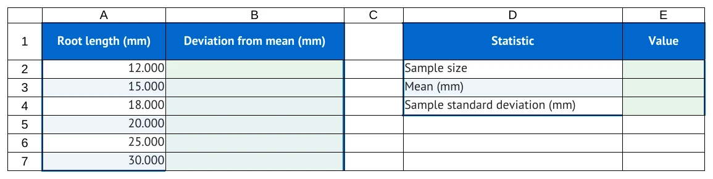
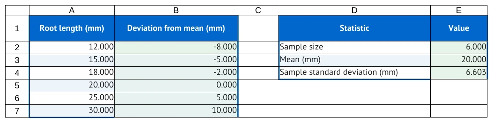

# Change a worksheet safely

Use this page when adding observations, adding a calculation, or moving an existing layout.
A source table, its action targets, and its formulas describe the same worksheet. Review them
together whenever that worksheet changes.

Follow the course at [../STUDENT_GUIDE.md](../STUDENT_GUIDE.md), or return to
[../FORMATTING_GUIDE.md](../FORMATTING_GUIDE.md) for the topic index.

## Add one observation

The first Roots worksheet contains five synthetic measurements: 12, 15, 18, 20, and 25 mm.
Add a sixth measurement, 30 mm, at the bottom of the Workbook table. It occupies A7.

```markdown
| Root length (mm) |
| --- |
| 12 |
| 15 |
| 18 |
| 20 |
| 25 |
| 30 |
```

Extend the source region to A1:A7. Then revise the summary instructions to include the new row:

| Destination | Before | After |
| --- | --- | --- |
| E2 | `=COUNT(A2:A6)` | `=COUNT(A2:A7)` |
| E3 | `=AVERAGE(A2:A6)` | `=AVERAGE(A2:A7)` |
| E4 | `=STDEV.S(A2:A6)` | `=STDEV.S(A2:A7)` |

The new count is 6.000, mean is 20.000 mm, and sample SD displays 6.603 mm.
Update any worked numbers and explanations that depend on the old five-observation dataset.
Changing the table alone does not rewrite the Tutorial instructions.

## Add a calculation column

Add a Deviation (mm) heading in B1 and blank work cells in B2:B7. Give every table row its
second cell, including the separator row. Declare B1:B7 as a calculation region.

```markdown
1. In cell B2, enter:
   [`=A2-$E$3`](enter:B2)
2. [Fill B2:B7](fill:B2:B7) down to include all six observations.
```

<!-- screenshots:begin (managed by screenshot-docs) -->


<!-- screenshots:end -->

Compare the same cells in both views. The starter supplies headings and measurements; the
completed view demonstrates the results after following the instructions. The last deviation
is 10.000 mm. A fill stopping at B6 would leave that final result missing.

## Move the layout together

Suppose you insert a new blank column A before the existing content. Every existing column moves
one place right. The fixed reference moves too, because the mean itself has moved:

| Item | Original layout | After insertion |
| --- | --- | --- |
| Root observations | A2:A7 | B2:B7 |
| Deviation work | B2:B7 | C2:C7 |
| Summary table | D1:E4 | E1:F4 |
| Mean cell | E3 | F3 |
| First deviation | `=A2-$E$3` in B2 | `=B2-$F$3` in C2 |

Change the Workbook table placement, region coordinates, action targets, formula inputs,
and visible cell instructions. Dollar signs preserve a reference during filling; they do not
excuse leaving a moved mean at its old address in the source.

<!-- screenshots:begin (managed by screenshot-docs) -->

<!-- screenshots:end -->

Read the column letters. The same measurements and results now occupy different addresses.
A correct-looking result in an old example does not prove the revised instructions agree.

## Choose manual editing or preview

Manual edits are useful while learning the connections: revise each table, formula, action,
and sentence yourself, then lint and build. For an existing layout, the worksheet editor can
preview coordinated edits. Run from the repository root:

```bash
source source_me.sh
python3 make_tutorial.py worksheet-edit docs/examples/authoring_course/root_06_grow.md \
  --sheet Roots insert-columns --at A --count 1
```

The command prints a preview and leaves the file unchanged. Read the diff and review notices.
To apply the reviewed edit, repeat the command with `--write`. Work on your own copy when you
want to preserve the course checkpoint.

The helper updates declared geometry, marked spreadsheet formulas, semantic targets, and explicit
cell instructions. It retains scientific prose and worked numerical explanations for your review.
A notice is a request to inspect a passage, not evidence that its scientific meaning was updated.

## Rebuild and inspect

Lint the revised source, build the document and starter workbook, and follow its instructions
in a separate completed workbook. Check the first and final observations, every summary range,
and the last filled result. Keep the starter's student work cells blank.

Practice in [../learn/PART_3_IMPROVE.md](../learn/PART_3_IMPROVE.md#step-grow-the-data-set), comparing
[../examples/authoring_course/root_06_grow.md](../examples/authoring_course/root_06_grow.md) with
[../examples/authoring_course/root_07_move.md](../examples/authoring_course/root_07_move.md).
For command details, see
[../USAGE.md](../USAGE.md#maintain-a-worksheet-after-a-layout-decision).
