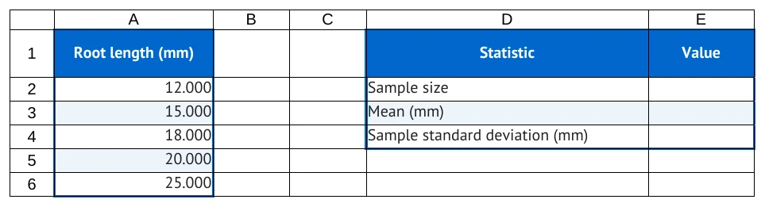
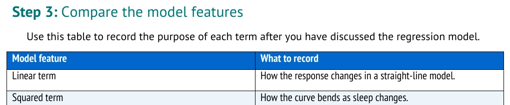

# Map tables to worksheets

Use this page when you need to supply measurements, labels, and space for student calculations.
The Workbook section defines the starting sheet; Tutorial actions describe what students do next.

Start the course at [../STUDENT_GUIDE.md](../STUDENT_GUIDE.md), or find another topic in
[../FORMATTING_GUIDE.md](../FORMATTING_GUIDE.md).

## Supply the observations

This source supplies five synthetic root lengths in millimeters:

```markdown
## Workbook

### Sheet: Roots

| Root length (mm) |
| --- |
| 12 |
| 15 |
| 18 |
| 20 |
| 25 |

- **Region A1:A6:** source
```

The first table under a Sheet heading starts at A1. The heading is real spreadsheet content.
The separator line tells Markdown where the header ends; it does not become a spreadsheet row.

| Source line | Spreadsheet cell | Supplied value |
| --- | --- | --- |
| Header | A1 | Root length (mm) |
| Separator | None | None |
| First observation | A2 | 12 |
| Last observation | A6 | 25 |

A sheet name connects source tables to actions. Use the same spelling in the Tutorial Part's
`- **Worksheet:** Roots` declaration.

## Place a summary table

An `At:` heading sets the upper-left cell of the next table. This table starts at D1:

```markdown
#### At: D1

| Summary | Value |
| --- | --- |
| n | |
| Mean (mm) | |
| Sample SD (mm) | |

- **Region D1:E4:** results
```

The summary labels occupy D2:D4. Their calculation cells E2:E4 are blank. The blank entries are
intentional work areas; `0` would supply a number instead.

<!-- screenshots:begin (managed by screenshot-docs) -->

<!-- screenshots:end -->

Read the column letters and row numbers in the crop. The summary's Value heading is at E1,
so the first formula belongs in E2. The empty column space separates observations from results.

## Give each area meaning

Regions describe a worksheet area's purpose:

| Role | Use |
| --- | --- |
| `source` | Measurements or other supplied information |
| `calculation` | Intermediate work such as deviations |
| `results` | Summary values such as mean and sample SD |
| `interpretation` | Space for written explanations |

Roles control presentation; they do not add labels or formulas. Supply headings in the tables.
Keep declared regions separate: two explicit regions cannot overlap.

A table supplies a rectangular block. Give every row the same number of cells, including blank
cells. To add a blank calculation column, add its heading, separator cell, and a blank cell to
every observation row.

## Separate seeds from work

Anything written in a Workbook table is supplied to students. This includes formulas.
If students should calculate the mean, leave E3 blank and write the action in Tutorial:

```markdown
1. In cell E3, enter:
   [`=AVERAGE(A2:A6)`](enter:E3)
```

Do not also put `=AVERAGE(A2:A6)` in the Workbook table. That gives away the formula and conflicts
with asking a student to enter it into an empty cell. Supplied labels need no `label:` action.

## Recognize the document table

The same pipe-table punctuation under Tutorial makes a table in the document. It does not put
anything into the spreadsheet. Use that location for explanations or comparison notes.

<!-- screenshots:begin (managed by screenshot-docs) -->

<!-- screenshots:end -->

The crop illustrates document styling. Compare it with the worksheet grid above before choosing
where a new table belongs.

## Check the layout

Before building, read the source table as cell addresses. Check its first and last observation,
its summary's upper-left corner, and its blank targets. After building, inspect the actual XLSX.

Practice in [../learn/PART_1_CREATE.md](../learn/PART_1_CREATE.md#step-design-the-worksheet), using
[../examples/authoring_course/root_03_layout.md](../examples/authoring_course/root_03_layout.md).
Continue with [FORMULAS.md](FORMULAS.md) to calculate in the blank cells.
For exact table rules, see [../TUTORIAL_SPEC.md](../TUTORIAL_SPEC.md#workbook-authoring).
