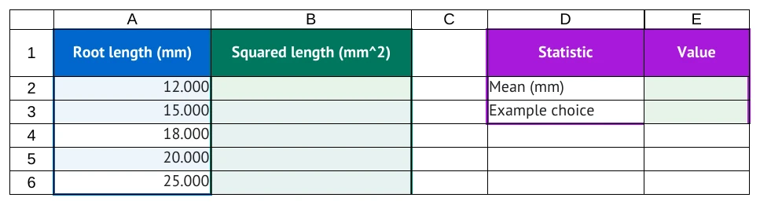
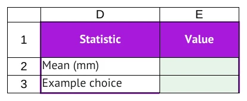
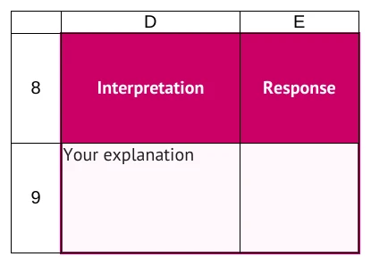

# Build the workbook

Use this page when you decide what the reader receives in the spreadsheet before following the
tutorial. Tables under `## Workbook` supply cells; Tutorial actions describe student work.

Return to [../AUTHORING_GUIDE.md](../AUTHORING_GUIDE.md) or the
[../FORMATTING_GUIDE.md](../FORMATTING_GUIDE.md) visual index.

## Supply a starting table

Type this Markdown:

```markdown
## Workbook

### Sheet: Roots

| Root length (mm) | Squared length (mm^2) |
| --- | --- |
| 12 | |
| 15 | |
| 18 | |
| 20 | |
| 25 | |

- **Region A1:A6:** source
- **Region B1:B6:** calculation
```

The full workbook crop includes the result table defined in the next section.
The table begins at A1. The header row is real spreadsheet content; the `---` row is not.
Blank table cells are blank cells, not zeroes. The regions describe presentation roles.

<!-- screenshots:begin (managed by screenshot-docs) -->

<!-- screenshots:end -->

Choose meaningful headers before styling. The four supported region roles are `source`,
`calculation`, `results`, and `interpretation`; regions must not overlap.

## Place another table

Type this Markdown before the next table:

```markdown
#### At: D1

| Statistic | Value |
| --- | --- |
| Mean (mm) | |
| Example choice | |

- **Region D1:E3:** results
```

`At: D1` places the next rectangular table at D1. It does not affect later tables.

<!-- screenshots:begin (managed by screenshot-docs) -->

<!-- screenshots:end -->

Use a separate table when it makes the worksheet easier to read. Table rows must have the same
number of cells, and tables cannot overlap.

## Leave room for interpretation

Type this Markdown:

```markdown
#### At: D8

| Interpretation | Response |
| --- | --- |
| Your explanation | |

- **Region D8:E9:** interpretation
```

<!-- screenshots:begin (managed by screenshot-docs) -->

<!-- screenshots:end -->

The author chooses the prompt and whether students write in the workbook. The `interpretation`
role changes presentation only; it does not create a question or validate the response.

## Choose what a cell stores

| Markdown table cell | Stored spreadsheet value |
| --- | --- |
| Empty cell | Blank cell |
| `12` or `-1.2e3` | Number |
| `TRUE` or `FALSE` | Boolean |
| `=AVERAGE(A2:A6)` | Formula supplied to the reader |
| `"001"` | Literal text, including leading zeroes |
| Plain words | Text |

Use `\|` for a literal pipe in a table cell. A leading `=` is required for a formula. Numeric,
formula, and blank work cells display three decimal places by default; that changes display, not
stored precision.

## Keep starting cells separate from work

Anything in Workbook is supplied. If a reader must create a formula, leave the target cell blank
here and describe it with an action in Tutorial. Do not supply the same formula and ask the reader
to enter it again.

Add another `### Sheet: <name>` for each worksheet. Sheet names must be unique, at most 31
characters, and cannot contain `:`, `\\`, `/`, `?`, `*`, `[`, or `]`. See
[ACTIONS.md](ACTIONS.md) to connect the workbook to instructions and
[../TUTORIAL_SPEC.md](../TUTORIAL_SPEC.md) for all table rules.

## Use more than one sheet

Add the following under Workbook to create a Summary tab alongside the example's Roots tab:

```markdown
### Sheet: Summary

| Result | Value |
| --- | --- |
| Example value | |
```

Then add a Tutorial Part that selects the Summary sheet. Quoted sheet names let formulas use
cells on another worksheet:

```markdown
### Part: Work on the summary sheet

- **Worksheet:** Summary

#### Step: Enter a value

1. In cell B2, enter [`='Roots'!A2`](enter:B2).
```

Each Part in a document with multiple worksheets needs its own Worksheet declaration. Use the
declared sheet spelling; worksheet names are unique ignoring case. A declaration scopes the whole
Part. It does not add a worksheet to Workbook.

## Preserve literal cell text

Workbook cells support plain text, named entities, `br` line breaks, and one surrounding code span.
Use JSON double quotes to preserve text such as `"001"`, `"TRUE"`, or `"=not a formula"`.
An empty quoted string (`""`) differs from a blank cell. For a line break in a text value, use
`"first line\nsecond line"` in a code span; the JSON escape becomes a newline.

Use decimal numbers such as `0.05` for stored values. The compiler does not infer percentages,
dates, currency, or thousands separators. Put units in headings so measurements stay numeric.

## Add Google links optionally

After importing your workbook into Google Sheets, you can add a `Google Sheets` declaration
before a sheet's first table. The following URL is a placeholder; substitute your actual URL
and the sheet's numeric `gid`:

```text
- **Google Sheets:** https://docs.google.com/spreadsheets/d/SPREADSHEET_ID/edit#gid=TAB_ID
```

This lets generated cell links refer to that Google tab. It does not upload files, change sharing,
or verify the destination. A personal copy can have different IDs. Leave the declaration out
when you only need local output; the missing-mapping note does not block a build.
