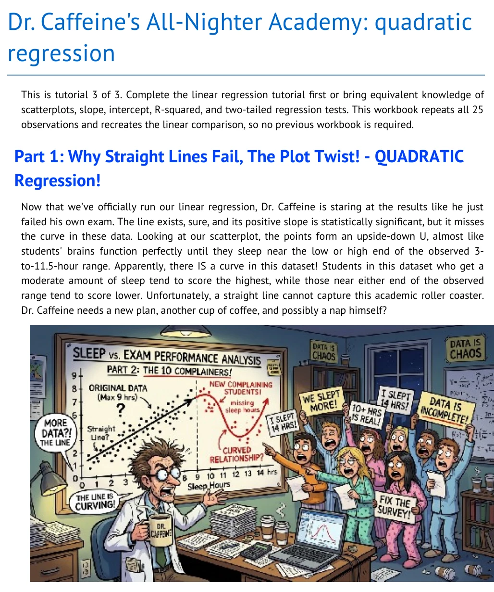
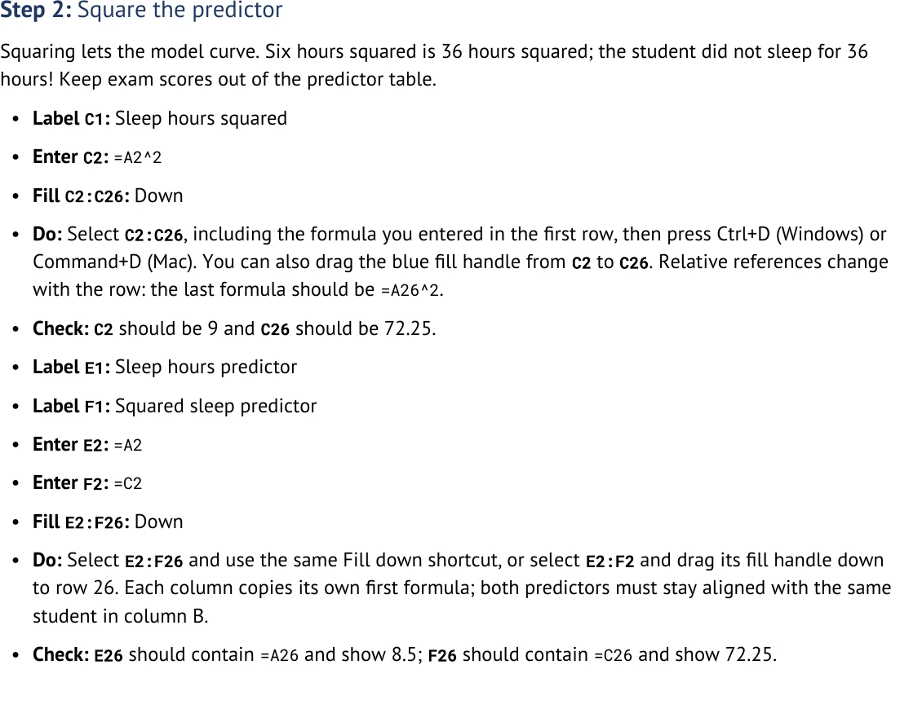
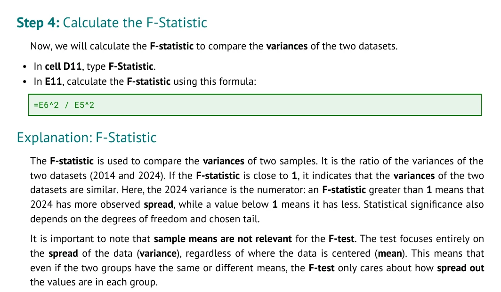
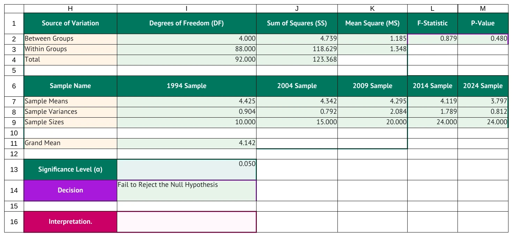

# Screenshot capture receipt

Captured 2026-10-23 UTC from the current canonical tutorial outputs. These four views demonstrate
the publishing pipeline's illustrated document opening, scannable spreadsheet actions,
formula treatment, and a completed calculation example. The rendered
instruction excerpts preserve the source writing while the renderer supplies the hierarchy,
indentation, justification, and formula styling.

## Gallery









| Asset | Actual view | Dimensions | Bytes |
| --- | --- | --- | ---: |
| `caffeine_3_illustrated_opening.webp` | PDF page 1: title, research story, and embedded illustration | 1028 x 1230 | 279774 |
| `caffeine_3_fill_down_instructions.webp` | PDF page 4: complete Step 3, formula, and justified teaching aside | 1064 x 350 | 45832 |
| `microbes_4_formula_instruction.webp` | PDF page 3: F-statistic spreadsheet action, standalone formula, and explanation | 1064 x 620 | 85526 |
| `microbes_5_completed_anova.webp` | Disposable completed demonstration of the styled Microbes 5 ANOVA worksheet, H1:M16 | 1507 x 686 | 71726 |

The completed ANOVA image is a demonstration, not the student starter workbook. It starts with
the canonical styled starter, applies only the authored baseline label and formula actions in a
disposable copy, and has LibreOffice Calc calculate it before rendering. The canonical starter
remains unchanged. This completed view does not establish that the starter has an appropriate
instructional structure. Authors should establish labels before the compiler applies styling;
tutorial users should normally receive those labels already present.

The capture harness fingerprinted all 12 Markdown sources and their 36 canonical DOCX, PDF, and
XLSX outputs before and after capture. All 48 protected files were unchanged. The machine-readable
[capture receipt](capture_receipt.json) records the current SHA-256 fingerprints, each image hash,
and the completed-demo provenance.

All WebPs were encoded with `cwebp -q 90` under `/tmp`, visually inspected after encoding, and are
within the 1920-pixel edge and 1 MB limits. These four images are the complete managed set.
Removed `caffeine_3_blank_predictor_workspace.webp`: its unlabeled colored areas obscured the
worksheet's purpose and did not demonstrate useful authoring or learner behavior. No other stale
images, retained reference images, or capture gaps remain.

## Reproduce the capture

Use [../../devel/capture_readme_artifacts.py](../../devel/capture_readme_artifacts.py) after
building the canonical outputs. This optional documentation workflow requires the existing
application environment, Poppler (`pdftoppm`), WebP (`cwebp`), LibreOffice, and the
screenshot-docs skill renderer. These capture tools are not application runtime dependencies.
Run the entire command outside the macOS sandbox because it invokes LibreOffice:

```bash
source source_me.sh && python3 devel/capture_readme_artifacts.py \
  --artifact-renderer /Users/vosslab/nsh/vosslab-skills/skills/documentation/screenshot-docs/scripts/render_artifact_libreoffice.sh
```

The script uses a fresh temporary workspace, refreshes the same four asset names,
writes [capture_receipt.json](capture_receipt.json), and fails if a canonical source or built
artifact changes during capture.
