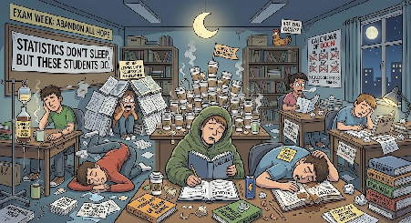
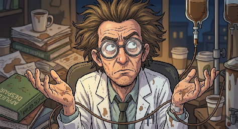
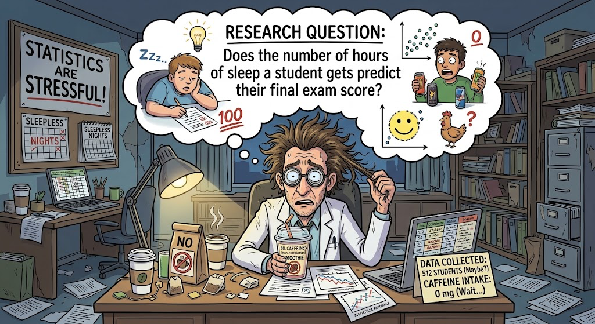
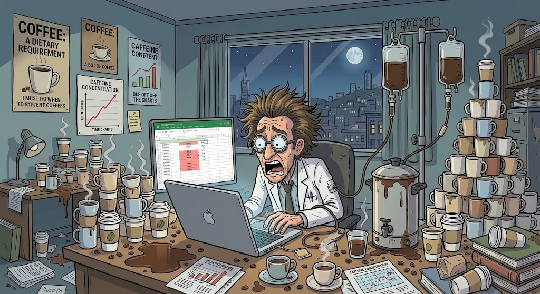
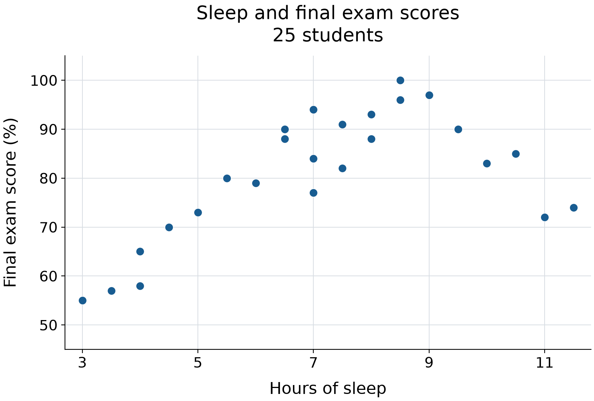
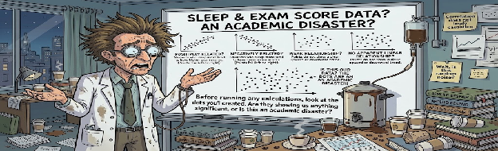
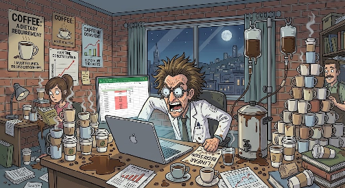

# Dr. Caffeine's All-Nighter Academy: linear regression

This is tutorial 2 of 3. Familiarity with spreadsheet entry and descriptive statistics is helpful. The workbook repeats all 25 observations, so no completed previous workbook is required.

**Does Sleep Affect Exam Scores?**

*Linear regression is a statistical method that models the relationship between two quantitative variables by fitting a straight line to the data. It can help us describe the direction and strength of a linear relationship and evaluate whether the data provides evidence of an association between the variables.*

## Workbook

### Sheet: Sleep and scores

| Hours of Sleep | Exam score (%) |
| --- | --- |
| 3 | 55 |
| 3.5 | 57 |
| 4 | 58 |
| 4 | 65 |
| 4.5 | 70 |
| 11 | 72 |
| 5 | 73 |
| 11.5 | 74 |
| 7 | 77 |
| 6 | 79 |
| 5.5 | 80 |
| 7.5 | 82 |
| 10 | 83 |
| 7 | 84 |
| 10.5 | 85 |
| 6.5 | 88 |
| 8 | 88 |
| 6.5 | 90 |
| 9.5 | 90 |
| 7.5 | 91 |
| 8 | 93 |
| 7 | 94 |
| 8.5 | 96 |
| 9 | 97 |
| 8.5 | 100 |

- **Region A1:B26:** source
- **Region D1:E14:** calculation
- **Region G1:H5:** results
- **Region J2:K10:** results
- **Region M2:O12:** interpretation

## Tutorial

### Part: **Scenario:**

Welcome to the **All-Nighter Academy**, where the coffee is strong, the students are exhausted, and the final exams are approaching!

Dr. Caffeine has noticed that some students stay up late studying while others prioritize getting a full night&#8217;s sleep. He suspects that the amount of sleep students get may be related to their final exam scores.

But is there ***actually*** a relationship between sleep and exam performance, or is Dr. Caffeine just running on too much caffeine? In this tutorial, you will use Google Sheets to explore the relationship between students&#8217; hours of sleep and their final exam scores. We&#8217;ll start by using linear regression to fit a straight line to the data. But what happens when students who get *too much* sleep start scoring lower on their exams? A straight line might not tell the whole story! We&#8217;ll then explore quadratic regression to see if a curved model might better describe the relationship. Grab your coffee, let&#8217;s get into it.

**Research Question**

*Does the number of hours of sleep a student gets predict their final exam score?*

**

**Hypotheses: What are we actually testing?**

**Null Hypothesis H0:** There is no linear relationship between hours of sleep and final exam scores in the population. (the regression slope is zero)

**Alternative Hypothesis H1:** There is a linear relationship between hours of sleep and final exam scores in the population. (the regression slope is not zero)

Basically, we&#8217;re testing whether there is evidence of a straight-line relationship between sleep and exam scores. Dr. Caffeine wants answers, and we have statistics!

#### Step: **Set Up Your Google Sheet**

1. Open this tutorial's generated XLSX workbook in Google Sheets, containing the template data created by your favorite grad students.
2. Make a personal copy of the Google Sheet by going under **File** and &#8220;**Make a Copy**&#8221;
3. Rename your spreadsheet with your name and the date
4. Use the **Sleep and scores** tab throughout; A1:B26 contains all 25 paired observations. Keep each student's pair together. Enter each formula in its named cell, including the opening =, then press Enter. Record written responses in M2:O12 or in accompanying notes.

#### Step: **Identify Variables**

**Before performing any calculations, we need to identify the two variables in the study.**

For both regression tutorials, we will be using the data in the Google Sheets **Sleep and scores** tab.

1. **X (predictor):** hours of sleep a student gets\
   * Column **A** of **Sleep and scores** tab\
2. **Y (response):** the student&#8217;s final exam score\
   * Column **B** of **Sleep and scores** tab

In this scenario, sleep is the predictor variable, and exam score is the response variable. We are investigating whether students&#8217; sleep duration can help predict their exam scores. *This does not automatically mean that sleep causes a change in exam performance.* Other factors, such as studying habits, stress, and maybe lack of or too much caffeine intake, may also affect scores.

#### Step: **Make a scatter plot**

Before calculating a regression equation, it&#8217;s important to visualize the data. A scatterplot allows us to view the direction, form, and strength of the relationship between sleep hours and exam scores. Basically, each student becomes a dot; statistically useful.\
\

##### Substep: **Create the chart**

1. Find the &#8216;Hours of Sleep&#8217; and &#8216;Exam Score (%)&#8217; columns already supplied in the &#8216;Sleep and scores&#8217; tab\
2. [Highlight the columns containing hours of sleep (**A**) and final exam scores (**B**), including the column headings](select:A1:B26)\
3. Select **Insert &#8594; Chart**\
4. In the Chart editor, choose **Scatter chart** as the chart type.\
5. Make sure hours of sleep are on the x-axis and exam scores are on the y-axis\
6. Add an informative chart title, such as *Hours of Sleep vs. Final Exam Scores*\
7. Label the axes:\
   * Horizontal axis: Hours of Sleep\
   * Vertical axis: Final Exam Score (%)

##### Substep: **Examine the relationship: What is our Scatterplot even Telling us?**

Before running any calculations, look at the dots you have created. Are they showing us anything significant, *or is this an academic disaster?*

* **Positive relationship:** students who sleep more tend to have higher exam scores. The points generally rise from left to right.\
  * **Negative relationship:** students who sleep more tend to have lower exam scores. The points generally fall from left to right\
  * **Weak relationship:** the points show a general upward or downward trend, but they are widely scattered instead of closely following a straight line\
  * **No apparent linear relationship:** the points do not show a clear upward or downward trend. However, they may still show a pattern, like a curve

**Pause and predict:** Based on your scatterplot, do you expect the relationship between sleep and exam scores to be positive, negative, weak, or strong? Record your prediction before moving on. Don&#8217;t worry about getting it right just yet, we&#8217;re about to put this data to work.

#### Step: **Calculate linear regression**

Now that you have visualized the data, you can use linear regression to describe the relationship mathematically.

**Simple Linear Regression:** Finds the straight line that best represents the overall pattern of the dots (each student is a dot on a scatterplot).

**A simple linear regression equation is:**\
**Predicted exam score =** intercept + slope x hours of sleep\

y-hat = b0 + b1 x

**Don&#8217;t let the symbols scare you. Here&#8217;s what they actually mean**:

y-hat = Predicted exam score\
b0 = Intercept: predicted score at 0 hours of sleep\
b1 = Slope: predicted change in score for each additional hour of sleep\
x = Hours of sleep

**To calculate in Google Sheets:**

Label D1 [Regression measure](label:D1) and E1 [Calculated result](label:E1).

1. In cell **D2**, enter [Slope](label:D2)\
2. In cell **E2**, use the SLOPE function to calculate the sample slope:\
   * Enter: [=SLOPE(B2:B26,A2:A26)](enter:E2)\
   * This formula calculates the slope of the best-fitting straight line through the data. In other words, it tells us how much the predicted exam score changes for every additional hour of sleep.\
3. In cell **D6**, enter [Intercept](label:D6)\
4. In cell **E6**, use the INTERCEPT function to calculate the intercept of the regression line:\
   * Enter: [=INTERCEPT(B2:B26,A2:A26)](enter:E6)\
5. In cell **D10**, enter [R-squared](label:D10)\
6. In cell **E10**, use the RSQ function to calculate the sample&#8217;s R²:\
   * Enter: [=RSQ(B2:B26,A2:A26)](enter:E10)\
   * This formula calculates the coefficient of determination, R², which describes the proportion of variation in exam scores explained by hours of sleep.\
7. **Display the regression equation on the chart:**\
   * Select the scatterplot\
   * Open the Chart Editor and select **Customize &#8594;  Series**\
   * Turn on the Trendline and select Linear\
   * Under the trendline options, select **Use Equation.**\
   * Optionally, display R² on the chart if this is available on your screen! Make sure the equation plus the R² displayed on your chart actually corresponds to the same data used in your calculations!

#### Step: **Interpret the linear regression**

##### Substep: **Okay, now we have our equation, but what does it actually mean?**

Let&#8217;s use a hypothetical example:

**Predicted exam score = 45 + (5 x hours of sleep)**

**Intercept (45):** The model predicts an exam score of 45% for a student who gets 0 hours of sleep. This may not be practically meaningful.

**Slope (5):** For each additional hour of sleep, the predicted exam score increases by 5 percentage points, on average.

These values are hypothetical examples! Use actual values from your own spreadsheet when you are interpreting your results, and also remember that the slope describes an association and does not prove that the additional sleep causes higher exam scores.

##### Substep: **Use the calculated slope and intercept from Dr. Caffeine&#8217;s data to write an interpretation in your reflection notes:**

* **Slope (E2):**\
  1. As hours of sleep increase by one hour, the predicted final score changes by approximately [insert your slope] points, on average.\
     2. A positive slope indicates an upward linear trend, while a negative slope indicates a downward linear trend. Think back to your prediction in **section 3.2,** based on your calculations in this section, which trend are you observing in this data?\
  * **Intercept (E6):**\
    1. The intercept represents the predicted exam score when a student gets zero hours of sleep. What is the predicted exam score for a student who receives zero hours of sleep in Dr. Caffeine&#8217;s study?\
    2. Note: *although the intercept is necessary to define the regression line, this prediction may not be practically meaningful if &#8216;0 hours&#8217; falls outside the range of sleep durations in our dataset.*\
  * **Use the simple linear regression equation to make a prediction:**\
    1. Use the simple linear regression equation y-hat = b0 + b1 x  to predict the score for a student who gets 7 hours of sleep.\
    2. Substitute x = 7\
       1. y-hat = b0 + b1(7)\
    3. Use your own slope and intercept to calculate the predicted score. Label D14 [Predicted score at 7 hours](label:D14) and enter [=E6+E2*7](enter:E14) in E14. Remember that this is a model-based prediction, not a guarantee of what a student would actually score.

#### Step: **Evaluate regression**

A regression equation can describe a pattern, but we also need to see how well it fits the data, and if there&#8217;s statistical evidence of a linear relationship.

##### Substep: **Interpret R²**

1. R² describes the proportion of variation in the exam scores that is accounted for by the linear regression model using hours of sleep.\
2. For example, if R² = 0.60, then 60% of the variation in the exam scores is accounted for by the fitted linear regression model. However, R² alone does not tell us whether a straight line is the best way to describe the relationship.\
3. **Reflection Question.** Answer to following in your reflection notes:\
   1. What is the R² value for your linear regression model (cell E10), and what does this value tell you about how well the model fits the data?

##### Substep: **To determine whether there is actual statistical evidence of a linear relationship, we need to test the regression slope!**

We can test whether the population slope differs from zero with the following hypotheses:

* **H&#8320;: &#946;&#8321; = 0** &#8212; There is no linear relationship between sleep hours and exam scores in the population.\
* **H&#8321;: &#946;&#8321; &#8800; 0** &#8212; There is a linear relationship between sleep hours and exam scores in the population.

##### Substep: **Calculate the regression statistics in Google Sheets**

One way to obtain the necessary regression statistics is to use LINEST. The output contains the slope and intercept, their standard errors, and additional regression statistics. INDEX extracts individual values so no array spills into neighboring cells.

1. Label G1 [Regression Statistics](label:G1).
2. Label G2 [Slope](label:G2), and enter [=INDEX(LINEST(B2:B26,A2:A26,TRUE,TRUE),1,1)](enter:H2) in H2.
3. Label G3 [Standard error of slope](label:G3), and enter [=INDEX(LINEST(B2:B26,A2:A26,TRUE,TRUE),2,1)](enter:H3) in H3.
4. Label G5 [Residual degrees of freedom](label:G5), and enter [=INDEX(LINEST(B2:B26,A2:A26,TRUE,TRUE),4,2)](enter:H5) in H5. The slope should agree with E2, and the degrees of freedom should be 25 - 2 = 23.

##### Substep: **Calculate the t-statistic**

The t-statistic measures how many standard errors the slope is from zero

t = slope / standard error of slope

* In cell **J2,** enter [t-statistic](label:J2)\
  * Select cell **K2** and enter: [=H2/H3](enter:K2)

##### Substep: **Calculate the p-value**

In this step we will calculate the two-tailed p-value to test whether the slope differs from zero in either direction.\
Note: We would calculate a one-tailed p-value instead if we a had a specific directional hypothesis, for example if more sleep was associated with [higher|lower] exam scores, and we only wanted to test for evidence in that direction.

* In cell **J6,** enter [Residual degrees of freedom](label:J6)\
  * Select cell **K6** and enter: [=H5](enter:K6)\
  * In cell **J10,** enter [Two-tailed p-value](label:J10)\
  * Select cell **K10** and enter: [=T.DIST.2T(ABS(K2),K6)](enter:K10)

##### Substep: **Finally, let&#8217;s make a decision! Is Dr. Caffeine onto something?**

Okay, time to see if all that coffee-fueled studying is actually paying off! We&#8217;re going to use our p-value to decide whether there&#8217;s enough evidence to support a linear relationship between hours of sleep and exam scores.

Record the **two-tailed p-value for a slope differing from zero in either direction = _____**. Classical slope inference assumes an appropriate linear mean model with independent, normally distributed errors of constant variance; a p-value alone cannot check those assumptions.

Compare the p-value in **K10** with the significance level of **&#945; = 0.05**!

* **If p < 0.05:** Reject the null hypothesis! We have statistically significant evidence of a linear relationship between hours of sleep and exam scores. Dr. Caffeine might be onto something!\
* **If p &#8805; 0.05:** Fail to reject the null hypothesis. We don't have enough evidence to conclude that a linear relationship exists. Sorry, Dr. Caffeine, we can't blame the all-nighters just yet!\
* **Reflection Question:** What is the p-value for your linear regression model? Using the significance level, do you reject or fail to reject the null hypothesis? What does your decision tell you about the evidence for a linear relationship between hours of sleep and exam scores?\
  \* Just an Important note! *A p-value doesn't tell us how strong the relationship is, and it doesn't tell us the probability that the null hypothesis is true. It just helps us decide whether our data provide enough evidence against the null hypothesis. Statistics: humbling us one coffee at a time.*

#### Step: **Interpret results**

We&#8217;ve made our chart, calculated our regression equation AND tested our hypothesis. Now it&#8217;s time to take a step back and look at the bigger picture!

**Reflection Question:** Based on your scatterplot and the statistics calculated regarding it, does a straight line model appear to capture the overall pattern in the data? Why or why not?

Your slope should be about 3.18 percentage points per hour and R-squared about 0.347. A significant positive slope can coexist with curvature that a straight line misses. Include your labeled scatterplot, regression calculations, seven-hour prediction, two-tailed slope-test decision, and reflection notes for submission. Continue to the quadratic regression tutorial to investigate the curve.
