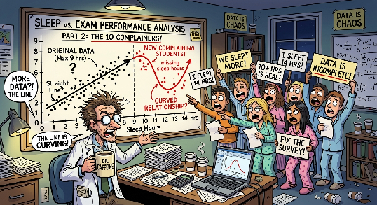
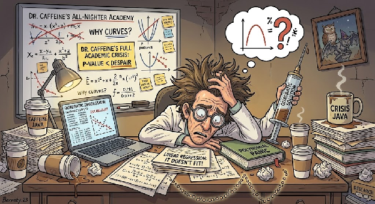
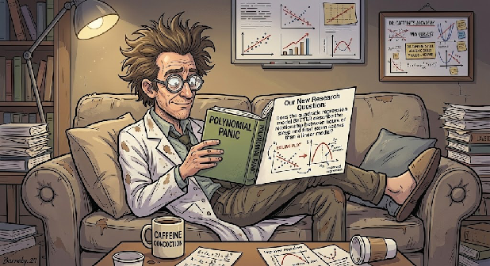
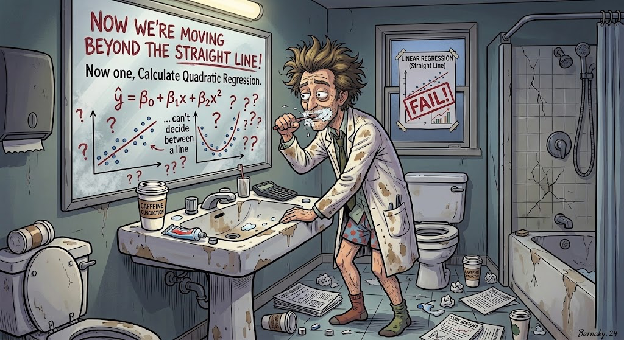
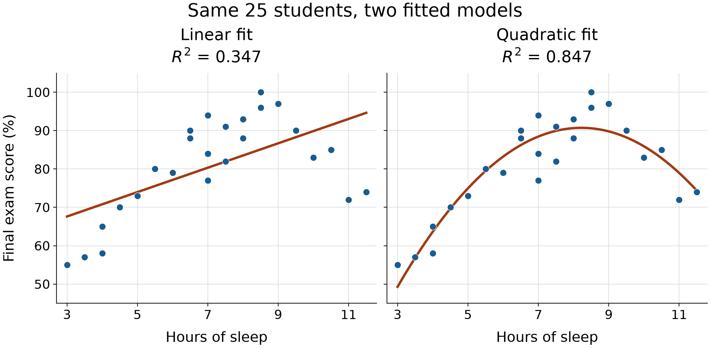
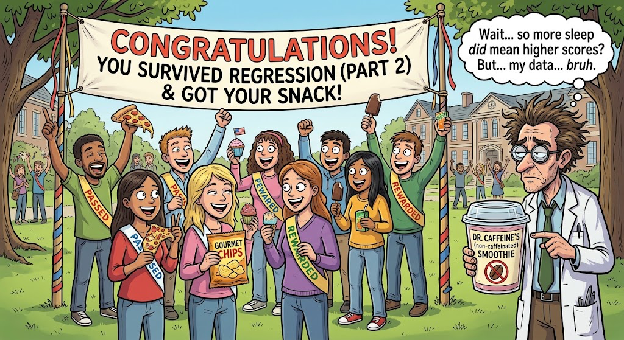

# Dr. Caffeine's All-Nighter Academy: quadratic regression

This is tutorial 3 of 3. Complete the linear regression tutorial first or bring equivalent knowledge of scatterplots, slope, intercept, R-squared, and two-tailed regression tests. This workbook repeats all 25 observations and recreates the linear comparison, so no previous workbook is required.

## Workbook

### Sheet: Sleep and scores

| Hours of Sleep | Exam score (%) |
| --- | --- |
| 3 | 55 |
| 3.5 | 57 |
| 4 | 58 |
| 4 | 65 |
| 4.5 | 70 |
| 11 | 72 |
| 5 | 73 |
| 11.5 | 74 |
| 7 | 77 |
| 6 | 79 |
| 5.5 | 80 |
| 7.5 | 82 |
| 10 | 83 |
| 7 | 84 |
| 10.5 | 85 |
| 6.5 | 88 |
| 8 | 88 |
| 6.5 | 90 |
| 9.5 | 90 |
| 7.5 | 91 |
| 8 | 93 |
| 7 | 94 |
| 8.5 | 96 |
| 9 | 97 |
| 8.5 | 100 |

- **Region A1:B26:** source
- **Region C1:C26:** calculation
- **Region E1:F26:** calculation
- **Region H1:I11:** results
- **Region L1:M4:** results
- **Region L7:N16:** interpretation

## Tutorial

### Part: **Why Straight Lines Fail, The Plot Twist! - QUADRATIC Regression!**

Now that we've officially run our linear regression, Dr. Caffeine is staring at the results like he just failed his own exam. The line exists, sure, and its positive slope is statistically significant, but it misses the curve in these data. Looking at our scatterplot, the points form an upside-down U, almost like students' brains function perfectly until they sleep near the low or high end of the observed 3-to-11.5-hour range. Apparently, there IS a curve in this dataset! Students in this dataset who get a moderate amount of sleep tend to score the highest, while those near either end of the observed range tend to score lower. Unfortunately, a straight line cannot capture this academic roller coaster. Dr. Caffeine needs a new plan, another cup of coffee, and possibly a nap himself?

#### Step: Set Up Your Google Sheet

1. Open the generated XLSX workbook in Google Sheets and make a personal copy under **File** and **Make a Copy**. Rename it with your name and date. Use **Sleep and scores**, where A1:B26 contains the same 25 paired observations. Keep each student's pair together; record written responses in L7:N16 or in accompanying notes.
2. [Select A1:B26](select:A1:B26), choose **Insert -> Chart**, and choose **Scatter chart**. Label the x-axis Hours of Sleep and the y-axis Final Exam Score (%), and add an informative title.
3. Recreate the linear comparison: label L1 [Linear comparison](label:L1), L2 [Slope](label:L2), L3 [Intercept](label:L3), and L4 [Linear R-squared](label:L4). Enter [=SLOPE(B2:B26,A2:A26)](enter:M2) in M2, [=INTERCEPT(B2:B26,A2:A26)](enter:M3) in M3, and [=RSQ(B2:B26,A2:A26)](enter:M4) in M4.

**Let's see why our linear regression is not giving what it needs to give.**

#### Step: **Straight Linear Regression**

1. **Add the Linear Trendline First:** On your scatterplot, open the Chart Editor and select **Customize -> Series**. Turn on the **Trendline** and select **Linear**. Make sure to display the equation and (R^2) value. We need receipts because Dr. Caffeine is NOT about to trust a line just because it looks official.\
2. **Observe the Disconnect:** Look at that straight line running through the middle of the scatterplot. Like... respectfully, what is going on here? Our data is forming a whole upside-down U, and this line is acting like everything is perfectly linear. Students who get a moderate amount of sleep tend to score higher, while those who barely sleep or sleep like they're in a three-day coma tend to score lower. The pattern is an academic roller coaster.\
3. **Check your linear receipts:** Use the linear R2 value in M4; if you completed the previous tutorial, it should agree with that result. Does it capture the rise and fall in the data? Dr. Caffeine has his coffee, we have our calculations, and yet this line is still not connecting the dots. R2 describes the variation accounted for by the linear fit; its value alone cannot show whether a straight line captures this pattern. At this point, we need to regroup.

**Time for QUADRATIC REGRESSION!** Since exam scores appear to peak at a moderate amount of sleep and decrease when students get either too little or too much, a curved model may better represent the relationship. Because apparently, sleep has a sweet spot, and statistics refuse to let us have a simple answer. Let's see if quadratic regression can save this project before Dr. Caffeine has a full academic crisis!

**Our New Research Question:** Does the quadratic regression model BETTER describe the relationship between hours of sleep and final exam scores than a linear model?

**Hypotheses for Quadratic Term:** This time, we're looking at whether adding a squared sleep-hours term provides evidence of curvature

* **H0: &beta;2 = 0** -- There is no quadratic term in the population model.\
* **H1: &beta;2 &ne; 0** -- There is evidence of a quadratic term in the population model

**Basically, we're asking whether the relationship needs a curve instead of a straight line.**

#### Step: **Create a SQUARED Sleep-Hours Column**

To let our regression model curve, we need to square our predictor variable (x).

1. Use blank column C in your spreadsheet.\
2. Label it [Sleep Hours Squared (x^2)](label:C1)\
3. If the sleep hours are in cell A2, enter: [=A2^2](enter:C2)\
4. Press Enter, then [drag the little blue square all the way down to the bottom](fill:C2:C26) to make sure it applies to all students! Basically, we're taking each student's hours of sleep and multiplying that number by itself. If someone slept 6 hours, their squared sleep value is 36! Don't worry, they didn't sleep for 36 hours!

#### Step: **Calculate Quadratic Regression**

Now we are moving beyond the straight line!\
**Quadratic Regression:** a type of polynomial regression that is curved with respect to x.\

Our Equation is:\
y-hat = b0 + b1 x + b2 x2

**Here's the breakdown:**\
y-hat = Predicted exam score\
b0 = intercept\
b1 x = linear term\
b2 x2 = quadratic term, which lets the relationship curve\
x = hours of sleep

*That extra x^2 term is what gives the model its curve.  Now that we know what all these symbols mean, let's get into Google Sheets and see whether or not your data actually is giving us a curve.*

This remains linear regression in its coefficients; the squared predictor lets the relationship curve with respect to sleep hours.

Prepare adjacent predictors: label E1 [Sleep Hours](label:E1) and F1 [Sleep Hours Squared](label:F1), enter [=A2](enter:E2) in E2 and [=C2](enter:F2) in F2, then [fill both predictor columns down to row 26](fill:E2:F26). Both predictors must remain aligned with the same student in column B; E26 should show 8.5 and F26 should show 72.25.

#### Step: **Run Quadratic Regression in Google Sheets**

We can use LINEST to fit the quadratic model by including both sleep hours and squared sleep hours as predictors. To avoid accidentally including exam scores as a predictor, use the separate adjacent predictor table in E2:F26 and the response range B2:B26. INDEX extracts scalar results without an array spilling into neighboring cells.

This tells Google Sheets to predict exam scores using both sleep hours and sleep hours squared! The first term captures the linear part of the relationship, while the squared term lets the model CURVE!

An important note, the output from LINEST can be a little confusing sometimes because it lists the coefficients in reverse order of the predictor columns. For our model:

* The first coefficient is for sleep hours squared\
* The second coefficient is for sleep hours\
* The last value in the first row is the intercept.

Once we have the coefficients, we can plug them into our quadratic equation and see what the model predicts for exam scores at different amounts of sleep.

Label H1 [Quadratic statistic](label:H1) and I1 [Value](label:I1), then calculate:

1. Label H2 [Quadratic coefficient b2](label:H2), and enter [=INDEX(LINEST(B2:B26,E2:F26,TRUE,TRUE),1,1)](enter:I2) in I2.
2. Label H3 [Linear coefficient b1](label:H3), and enter [=INDEX(LINEST(B2:B26,E2:F26,TRUE,TRUE),1,2)](enter:I3) in I3.
3. Label H4 [Intercept b0](label:H4), and enter [=INDEX(LINEST(B2:B26,E2:F26,TRUE,TRUE),1,3)](enter:I4) in I4.
4. Label H5 [Quadratic R-squared](label:H5), and enter [=INDEX(LINEST(B2:B26,E2:F26,TRUE,TRUE),3,1)](enter:I5) in I5.
5. Label H6 [Standard error of b2](label:H6), and enter [=INDEX(LINEST(B2:B26,E2:F26,TRUE,TRUE),2,1)](enter:I6) in I6. Label H7 [Residual degrees of freedom](label:H7), and enter [=INDEX(LINEST(B2:B26,E2:F26,TRUE,TRUE),4,2)](enter:I7) in I7; the result should be 25 - 3 = 22.
6. Write your fitted equation using I2:I4. Does the sign of b2 give an upside-down U? Unlike the straight-line slope, b1 alone is not the score change for every extra hour; the change also depends on sleep through the squared term. Label H8 [Predicted score at 7 hours](label:H8), and enter [=I4+I3*7+I2*7^2](enter:I8) in I8. Compare with the linear prediction M3 + M2 * 7; neither guarantees an individual student's score.

##### Substep: Test the quadratic term

For a **two-tailed** test, H0: beta2 = 0 versus H1: beta2 differs from zero in either direction, with the linear term retained. Use alpha = 0.05. Inference assumes a suitable quadratic mean model with independent normal errors of constant variance.

1. Label H10 [t-statistic for quadratic term](label:H10), and enter [=I2/I6](enter:I10) in I10.
2. Label H11 [Two-tailed p-value (quadratic term differs from zero)](label:H11), and enter [=T.DIST.2T(ABS(I10),I7)](enter:I11) in I11. Record the **two-tailed p-value for a nonzero quadratic term in either direction = _____**.
3. If p < 0.05, reject H0; otherwise fail to reject it. State your conclusion about evidence of curvature conditional on the model assumptions.

The nominal p-value assumes this model and test were chosen before examining the pattern. Because we selected the curve after seeing these same data, treat the p-value as exploratory: selecting a model after seeing a pattern can make the usual p-value too optimistic. Confirm curvature using new, independent data and a model specified before examining those data.

#### Step: **Compare the Models**

Okay, here comes the question! Did quadratic regression actually improve our model, or did we just make the equation more complicated for fun? Compare the R2 values from the linear and quadratic models in M4 and I5.

Remember:

* **Linear regression:** Models the relationship using a straight line.\
* **Quadratic regression:** Allows the relationship to curve.

A higher R2 means the model explains a larger proportion of the variation in the exam scores of this dataset. If your quadratic model has a higher R2, that will suggest that the curve fits these data better. HOWEVER! Adding another term will generally make R2 stay the same or even increase, so a higher value alone does not necessarily prove that quadratic regression is the better choice. Look at the actual pattern in the data, too. Does exam performance seem to increase with sleep and then level off? Do you see any curved pattern, or are we just trying to make the data tell us what we want to hear?

1. Open your scatterplot's **Chart Editor -> Customize -> Series -> Trendline**, change **Linear** to **Polynomial**, and set **Degree** to 2. Display the equation and R-squared. Compare the chart against your fitted coefficients, allowing for display rounding.
2. Combine the visual pattern, both R-squared values, and the exploratory quadratic-term test. What supports curvature? What residual checks or new-data performance would you examine before relying on the model?

#### Step: **Our final TAKEAWAY!**

**Congratulations! You survived two regression models, your reward is hopefully a better understanding of statistics and maybe a snack (no coffee.)**

Linear regression helps us describe a straight-line relationship between sleep and exam scores. Quadratic regression gives us the option to model a curved relationship, and comparing the two models helps us figure out whether that extra curve is actually useful.

One thing to remember: **A RELATIONSHIP DOES NOT AUTOMATICALLY MEAN CAUSATION!** Even if students who sleep more tend to score higher, this alone cannot prove that sleep caused their scores to improve. Other factors could be involved, including studying, stress, and how much caffeine Dr. Caffeine has been distributing. With that, class is dismissed! Drink some water, close the 50 browser tabs you have open, and PLEASE get some sleep!

The observed sleep range is 3 to 11.5 hours. These observations do not define a universally optimal sleep duration. A student asks for a prediction after 16 hours of sleep: why would that be extrapolation, and why do a higher R-squared and a significant term not justify it? Submit the labeled scatterplot with the quadratic trendline, both fitted equations and R-squared values, the seven-hour prediction, the two-tailed curvature-test decision, and your conclusion about association and model limits.
