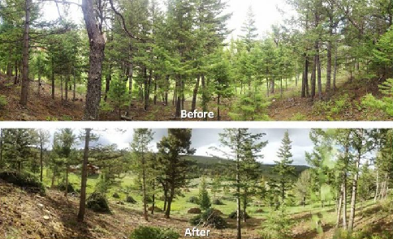
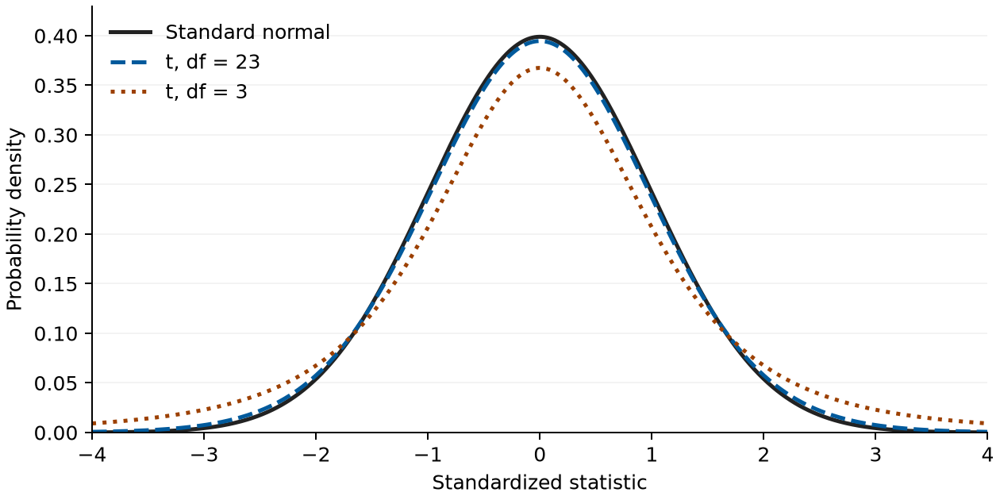

# **Microbial Diversity Two Sample T-Test Tutorial** **for BIOL 318/418**

## Workbook

### Sheet: Two Sample T-Test

- **Region A1:C101:** source
- **Region D1:G15:** calculation
- **Region D16:G18:** results
- **Region D21:E21:** calculation
- **Region D22:E24:** results
- **Region D26:E26:** interpretation

| "Sample Location" | `"2014\nShannon\nIndex "` | `"2024\nShannon\nIndex "` | "Statistical Names" | "Values" |
| --- | --- | --- | --- | --- |
| "Andrews Park" | 4.417 | 2.413 |  |  |
| "Beisner Road Entrance" | 5.359 | 3.853 |  |  |
| "Boat Launch Area" | 1.984 | 2.645 |  |  |
| "Busse Lake" | 6.923 | 4.871 |  |  |
| "Debra Park" | 1.412 | 2.357 |  |  |
| "Elk Pasture" | 4.677 | 4.281 |  |  |
| "Forest Central Grove" | 4.26 | 3.433 |  |  |
| "Forest North Grove" | 2.633 | 2.876 |  |  |
| "Forest South Grove" | 3.429 | 4.415 |  |  |
| "Forest West Grove" | 2.965 | 3.46 |  |  |
| "Lake Boating Center" | 4.728 | 2.64 |  |  |
| "Large Event Area" | 6.944 | 5.009 |  |  |
| "Main Dam" | 5.404 | 4.885 |  |  |
| "Main Pool" | 4.612 | 2.805 |  |  |
| "Marshall Park" | 5.028 | 4.733 |  |  |
| "Model Airplane Field" | 5.949 | 4.452 |  |  |
| "Nature Preserve" | 3.907 | 2.749 |  |  |
| "Ned Brown Meadow" | 4.305 | 3.635 |  |  |
| "North Pool" | 4.665 | 4.371 |  |  |
| "Osborn  Park" | 4.241 | 4.906 |  |  |
| "Salt Creek Trail" | 4.351 | 3.985 |  |  |
| "South Pool" | 3.791 | 3.849 |  |  |
| "Wildlife Refuge" | 4.079 | 3.521 |  |  |
| "Woodland Meadow" | 6.565 | 4.982 |  |  |

## Tutorial

### Part: Scenario

For this teaching scenario, assume representative independent observations from normally distributed populations. Choose the hypothesis and alpha = 0.05 before inspecting results; calculating all three tails is a comparison exercise, not permission to select the smallest p-value. Use Welch's independent-samples model with unknown, potentially unequal population variances. The same location names appear in both years: independence is a hypothetical assumption for this method exercise. Repeated measurements at matched sites require a paired analysis instead; verify the sampling design before applying this method to a field study.

Now that you have reanalyzed the microbial diversity in **Busse Woods** using a **T-test**, you have noticed the results did not support the significant difference that was initially found using the **Z-test**. This has raised new questions about whether **Busse Woods** is evolving under environmental pressures, such as **urbanization** and **climate change**.

However, rather than discarding the results, your advisor suggests a more insightful comparison: analyzing the changes in **microbial diversity** over time. By comparing the data from **2014** with your current data from **2024**, you can determine whether the diversity has decreased over the past decade. The **Two Sample T-test** will help you assess whether the population mean microbial diversity differs between the two years.

#### Why Use a Two Sample T-Test Now?

Unlike the earlier **T-test**, where you compared the current microbial diversity to a benchmark, the **Two Sample T-test** allows you to directly compare two different datasets-**2014** and **2024**-to determine if there has been a significant change over time. Welch's version of this test compares two independent groups without assuming equal population variances; small sample size alone is not the criterion for choosing it.

#### Step: Set Up Your Google Sheet for the Two Sample T-Test

1. Open the generated XLSX workbook in Google Sheets.
2. Select the **"Two Sample T-Test"** worksheet; its source data are already supplied.
3. Inspect the source observations before entering calculations.

The original course spreadsheet remains a [source reference](https://docs.google.com/spreadsheets/d/1cAlU997q8IazW6wJhBwYRrrO2l6ls0yCAo3Rx9BlUY0/edit).

Each year has 24 observations in rows 2:25. Formula ranges extend through row 101 for practice; empty observations are ignored, not treated as zeroes.

#### Step: Organize Your Sheet

1. The data will look like this:
   * **Column A**: Sample Location ID
   * **Column B**: **2014 Shannon Index** (microbial diversity from the 2014 dataset)
   * **Column C**: **2024 Shannon Index** (current microbial diversity data)
   * **Column D**: Statistical Names
   * **Columns E through G**: Calculated Values
2. Here's how to set it up:
   * In cell **D1**, the header already contains "**Statistical Names**".
   * In cell **E1**, the header already contains "**Values**".
   * In cell **F1**, type "**[Alternate Values 1](label:F1)**".
   * In cell **G1**, type "**[Alternate Values 2](label:G1)**".

#### Step: Calculate the Sample Statistics

Now, let us calculate the statistics needed for both datasets.

1. **Sample Means**:
   * In cell D2, type **[2014 Sample Mean](label:D2)**.
   * In **E2**, use the formula [`=AVERAGE(B2:B101)`](enter:E2) to calculate the sample mean for **2014**.
   * In cell D3, type **[2024 Sample Mean](label:D3)**.
   * In **E3**, use the formula [`=AVERAGE(C2:C101)`](enter:E3) to calculate the sample mean for **2024**.
2. **Sample Standard Deviations**:
   * In cell D5, type **[2014 Sample Standard Deviation](label:D5)**.
   * In **E5**, use the formula [`=STDEV(B2:B101)`](enter:E5) to calculate the sample standard deviation for **2014**.
   * In cell D6, type **[2024 Sample Standard Deviation](label:D6)**.
   * In **E6**, use the formula [`=STDEV(C2:C101)`](enter:E6) to calculate the sample standard deviation for **2024**.
3. **Sample Sizes**:
   * In cell D8, type **[2014 Sample Size](label:D8)**.
   * In **E8**, use the formula [`=COUNT(B2:B101)`](enter:E8) to count the number of samples for **2014**.
   * In cell D9, type **[2024 Sample Size](label:D9)**.
   * In **E9**, use the formula [`=COUNT(C2:C101)`](enter:E9) to count the number of samples for **2024**.

#### Step: Calculate the T-Statistic

Now, we will calculate the **T-statistic** for both the 2014 and 2024 datasets to better understand how far the sample means are from each other.

* In cell D11, type **[T-Statistic](label:D11)**.
* In **E11**, calculate the **T-statistic** using this formula:
  [`=(E3 - E2) / SQRT((E5^2/E8) + (E6^2/E9))`](enter:E11)

#### Explanation: T-Statistic

The **T-statistic** measures how far the sample means of 2014 and 2024 are from each other, relative to the variability in both samples. This is done by comparing the difference between the two means to the combined standard error, which accounts for both sample variances and sizes. A larger absolute **T-statistic** indicates a greater difference between the means relative to the variability, while a smaller absolute **T-statistic** suggests that the difference could be due to random variation. This allows us to determine whether the observed difference between the two years is statistically significant.

#### Step: Calculate the Degrees of Freedom

In a **Two Sample T-test**, calculating the degrees of freedom is more complex than simply subtracting one from each sample size, as in a one-sample test. Instead, the degrees of freedom are calculated using the **Welch-Satterthwaite equation**, which adjusts for differences in sample sizes and variances between the two groups being compared. This adjustment is especially important in biological and environmental studies, where unequal sample sizes and variances are common.

* In cell D13, type **[Degrees of Freedom](label:D13)**.
* In **E13**, use the formula [`=((E5^2/E8) + (E6^2/E9))^2 / ((E5^4/((E8^2)*(E8-1))) + (E6^4/((E9^2)*(E9-1))))`](enter:E13) to calculate the degrees of freedom.

#### Explanation: Why Use the Welch-Satterthwaite Equation?

The **Welch-Satterthwaite equation** combines the variances (squared standard deviations) and sample sizes of both groups, adjusting the degrees of freedom based on the ratio of the variances to their respective sample sizes. This approach accounts for differences in variability between the two groups and accounts for unequal sample sizes through the variance divided by sample size for each group. The adjustment ensures that the T-test is more conservative when there is greater uncertainty, such as when variances differ widely or sample sizes are small. In molecular biology, where variation in experimental data is common, this method provides a more reliable estimate of whether observed changes are statistically significant.

The formula you used in the spreadsheet automatically adjusts for the differences in your sample variances and sizes, giving you an approximate Welch degrees of freedom value. This ensures that your test results account for the natural variability in microbial diversity between 2014 and 2024, providing a clearer interpretation of statistical significance.

#### Example of Adjustments:

To better understand how the Welch-Satterthwaite equation accommodates different sample sizes and variances, consider the following scenarios:

| Name | Sample 1 Variance | Sample 1 Size | Sample 2 Variance | Sample 2 Size | Welch Degrees of Freedom |
| ----- | ----- | ----- | ----- | ----- | ----- |
| Both variances and sizes equal | 0.5 | 50 | 0.5 | 50 | 98.00 |
| Larger Sample 1 size, same variance | 0.5 | 50 | 0.5 | 25 | 48.11 |
| Much larger Sample 1 size, same variance | 0.5 | 50 | 0.5 | 10 | 12.87 |
| Same sample size, smaller Sample 2 variance | 0.5 | 50 | 0.4 | 50 | 96.80 |
| Same sample size, much smaller Sample 2 variance | 0.5 | 50 | 0.2 | 50 | 82.79 |
| Both variances and sizes unequal | 0.5 | 50 | 0.3 | 25 | 60.19 |

When both variances and sample sizes are equal, the **Welch-Satterthwaite equation** simplifies to the standard T-test formula for degrees of freedom. For two samples of 50, degrees of freedom are calculated as (50-1) \+ (50-1) \= 98\. This reflects the independent values in both groups. Each sample size is reduced by one to account for the population mean estimation. In this balanced scenario, no additional adjustment is needed.

As degrees of freedom increase, the **T-distribution** becomes closer to a **normal distribution**. For the same statistic, more degrees of freedom give lighter tails. Smaller degrees of freedom result in a wider T-distribution with fatter tails. This reflects greater uncertainty. When variances differ or sample sizes are small, the test becomes more conservative. A larger difference is needed to reject the null hypothesis.

In biological studies, this is important since sample sizes are often small. Lower degrees of freedom make it harder to detect significant results. This means the test is less sensitive. More degrees of freedom bring the reference distribution closer to normal; they do not guarantee reliable sampling or a significant result.

#### Step: Determine the Type of Test (One-Tailed or Two-Tailed)

Main lower-tail question: H0: mean2024 >= mean2014; H1: mean2024 < mean2014. The two-tailed comparison uses equality versus inequality; the higher-tail comparison uses H0: mean2024 <= mean2014 versus H1: mean2024 > mean2014.

In the **Two Sample T-test** comparing microbial diversity between 2014 and 2024, you need to decide if you are testing for any significant difference between the two years (a **two-tailed test**) or for a specific directional change (a **one-tailed test**).

* **Two-Tailed Test**: Use this when you want to determine if microbial diversity has significantly changed in **either direction** between 2014 and 2024\. This test considers whether the diversity is **either higher or lower** in 2024 compared to 2014\.
* **One-Tailed Test**: Use this when you have a specific hypothesis about the direction of the change. For example:
  * **Lower One-Tailed Test**: This test checks whether microbial diversity in 2024 is **lower** than in 2014, which may be relevant if you suspect urbanization has decreased biodiversity.
  * **Higher One-Tailed Test**: This test checks whether microbial diversity in 2024 is **higher** than in 2014, which could help assess whether biodiversity has unexpectedly increased.

In this case, you likely hypothesize that urbanization has **reduced** diversity, so a **lower one-tailed test** would be appropriate. However, both directions can be tested for a complete analysis.

#### Step: Calculate the P-Values

Use `BETADIST(x, a, b)` for the primary calculation: x = df / (df + t^2), a = df / 2, b = 0.5. This cumulative beta identity gives the two-tailed t probability using unrounded Welch df; some spreadsheet T.DIST functions truncate df to an integer. The beta identity need not be derived to interpret the result. T.DIST inputs are explained below for comparison, while the direct Welch T.TEST uses type 3.

Now that you have two sets of data (2014 and 2024 Shannon Index values), the next step is to calculate the **p-values** to assess whether the differences in microbial diversity between these two years are statistically significant. A **p-value** is the probability, under the null model and its assumptions, of a result at least as extreme in the specified tail or tails; it is not the probability that chance caused a difference or that the null hypothesis is true. If the p-value is below **0.05**, the difference is considered **statistically significant**.

In this step, you will calculate p-values for **two-tailed** and **one-tailed tests** (lower and higher). Each test evaluates whether microbial diversity has changed in either direction or specifically increased or decreased. You will use both **manual calculations** and the **T.TEST** function. The **T.TEST** function simplifies the process now that you are comparing two samples, which was not available for one-sample T-tests in Part 2\.

#### Explanation of T.DIST Inputs:

The function **`T.DIST`** calculates the **cumulative probability** for a given **t-statistic** and degrees of freedom. It is useful for both one-tailed and two-tailed tests, depending on how you handle the results. Here are the inputs:

* **T.DIST(x, degrees\_freedom, cumulative)**
  * **x**: This is the **t-statistic**, which represents how far the sample mean of 2024 is from the sample mean of 2014, relative to the standard error.
  * **degrees\_freedom**: This refers to the **degrees of freedom** of the two samples, calculated based on the Welch-Satterthwaite formula or a simpler approach if variances and sample sizes are equal.
  * **cumulative**: This specifies whether you want the **cumulative distribution function** (TRUE) or the **probability density function** (FALSE). You will use TRUE for calculating the cumulative probability.

In the case of a **two-tailed test**, you would multiply the smaller one-tailed probability by 2 to account for both tails of the distribution.

#### Explanation of T.TEST Inputs:

The function **`T.TEST`** simplifies the T-test by comparing the means of two datasets directly and returning the **p-value**. This function is useful for one-tailed or two-tailed tests, depending on the hypothesis. Here are the inputs:

* **T.TEST(array1, array2, tails, type)**
  * **array1**: This is the range of values for the first dataset (e.g., the 2014 Shannon Index values in column B).
  * **array2**: This is the range of values for the second dataset (e.g., the 2024 Shannon Index values in column C).
  * **tails**: This determines whether the test is **one-tailed (1)** or **two-tailed (2)**. For a one-tailed test, use 1; for a two-tailed test, use 2\.
  * **type**: This specifies the type of T-test. Use **3** for Welch's two-sample T-test with unequal variances (independent groups). Type 2 assumes equal variances; type 1 is paired.

The **T.TEST** function returns the **p-value**, which tells you whether the difference in means between the two datasets is statistically significant. A p-value less than or equal to the preselected 0.05 is statistically significant under the null model; it is not the probability that random variation caused the difference.

##### Substep: Two-Tailed Test:

This section will guide you through performing a **two-tailed test**. A two-tailed test evaluates whether microbial diversity in 2024 is significantly **higher or lower** than in 2014\. This test is used when there is no specific hypothesis about the direction of the difference, meaning the goal is to detect any significant change, whether it is an increase or a decrease.

Both a **manual calculation** and the **T.TEST** function will be used. The manual calculation will help you understand the process by breaking down the **T-statistic** and degrees of freedom. The **T.TEST** function simplifies the task by calculating the p-value directly, allowing for a quicker comparison between the two datasets.

#### Step-by-Step Tutorial:

1. In **column D**, type [`P-Value (Two-Tailed)`](label:D16) in **cell D16**.
2. In **cell E16**, you can use the following formula:
   * [`=BETADIST(E13 / (E13 + E11^2), E13 / 2, 0.5)`](enter:E16)
   * This calculates the two-tailed t probability using the squared T-statistic and unrounded Welch degrees of freedom: BETADIST(df / (df + t^2), df / 2, 0.5).
3. In **cell F16**, you can use the following formula:
   * [`=2 * MIN(E17, E18)`](enter:F16)
   * This doubles the smaller directional tail from E17 and E18; enter those formulas below before comparing the result.
4. In **column G**, use the **Quick Calculation using T.TEST**:
   * In **G16**, enter [`=T.TEST(C2:C101, B2:B101, 2, 3)`](enter:G16)
   * This directly compares the two datasets (Shannon Index for 2014 in column **B** and 2024 in column **C**) and calculates the two-tailed p-value automatically.

#### Explanation for Two-Tailed Test:

In a **two-tailed test**, you are checking whether the **microbial diversity** in 2024 is significantly **higher or lower** than in 2014\. The `BETADIST` formula calculates the p-value for both tails while retaining fractional Welch degrees of freedom. The second method doubles the smaller directional tail from E17 and E18; it updates once those formulas are entered.

Since you are now working with two samples in Part 3, you can use the **T.TEST** function, which simplifies the process significantly. Unlike in Part 2 (where only one sample was available), **T.TEST** directly compares the two datasets (2014 vs. 2024). It calculates the p-value automatically, saving time and reducing errors, while still allowing students to understand the underlying steps involved in manual calculations.

##### Substep: One-Tailed Test (for lower values):

This section focuses on performing a **one-tailed test** to determine if microbial diversity in 2024 is **lower** than in 2014\. A one-tailed test is used when there is a specific hypothesis. In this case, the hypothesis is that diversity has decreased due to environmental factors like **urbanization** or **climate change**.

Both the **manual calculation** and **T.TEST** function will be used to assess if there is a significant difference between 2014 and 2024\. The manual calculation will show how the cumulative probability for the **lower tail** of the distribution is derived. The **T.TEST** function provides a quicker way to compute the same result, offering both clarity and efficiency.

#### Step-by-Step Tutorial:

1. In **column D**, type [`P-Value (One-Tailed, Lower)`](label:D17) in **cell D17**.
2. In **cell E17**, use of the following formula:
   * [`=IF(E11 <= 0, E16 / 2, 1 - E16 / 2)`](enter:E17)
   * This selects half the two-tailed probability when t <= 0, and its complement otherwise, giving the probability at or below the signed statistic.
3. In **column G**, use the **Quick Calculation using T.TEST**:
   * In **G17**, enter [`=IF(E11 <= 0, T.TEST(C2:C101, B2:B101, 1, 3), 1 - T.TEST(C2:C101, B2:B101, 1, 3))`](enter:G17)
   * The IF uses the sign of E11 to select the lower tail; T.TEST with tails = 1 alone returns the smaller tail and does not specify direction.

##### Substep: One-Tailed Test (for higher values):

This section will test whether microbial diversity has **increased** between 2014 and 2024\. The focus will be on conducting a **one-tailed test** that checks for a significant **increase** in diversity. This test is useful when the hypothesis suggests that external factors, such as improved environmental conditions, have positively impacted microbial diversity over the years.

Both the **manual calculation** and the **T.TEST** function will be used here. The manual method involves calculating the probability of obtaining a T-statistic greater than or equal to the observed value, while the **T.TEST** function offers a faster alternative, calculating the p-value automatically to assess potential increases in diversity.

#### Step-by-Step Tutorial:

1. In **column D**, type [`P-Value (One-Tailed, Higher)`](label:D18) in **cell D18**.
2. In **cell E18**, use the following formula:
   * [`=IF(E11 >= 0, E16 / 2, 1 - E16 / 2)`](enter:E18)
   * This selects half the two-tailed probability when t >= 0, and its complement otherwise, giving the upper-tail probability.
3. In **cell F18**, use the following formula:
   * [`=1 - E17`](enter:F18)
   * This subtracts the lower-tail probability from one to obtain the upper-tail probability.
4. In **column G**, use the **Quick Calculation using T.TEST**:
   * In **G18**, enter [`=IF(E11 >= 0, T.TEST(C2:C101, B2:B101, 1, 3), 1 - T.TEST(C2:C101, B2:B101, 1, 3))`](enter:G18)
   * The IF uses the sign of E11 to select the higher tail; T.TEST with tails = 1 alone does not specify direction.

#### Step: Decision Using an IF Statement

In hypothesis testing, the decision to **reject** or **fail to reject** the **null hypothesis** depends on comparing the **p-value** to a predetermined **significance level** (&alpha;). The significance level is often set at **0.05**, meaning that if the p-value is less than or equal to 0.05, the result is considered **statistically significant**. This indicates that a result at least as extreme has a probability no greater than 0.05 under the specified null model. To simplify this decision process, we will use the **IF statement** in Google Sheets, which evaluates a condition and returns one value if the condition is true and another if it is false. In this case, we will check if the p-value is less than or equal to &alpha; (0.05).

#### Step-by-Step Tutorial:

* **In cell D21,** type **[Significance Level (&alpha;)](label:D21)**.
* **In cell E21,** enter **[0.05](enter:E21)**.
* **In cell D22,** type **[Two-Tail Decision](label:D22)**.
* **In cell E22,** use the formula
  * [`=IF(E16 <= E21, "Reject the Null Hypothesis", "Fail to Reject the Null Hypothesis")`](enter:E22)
  * to determine whether to reject the null hypothesis using the two-tailed test p-value.
* **In cell D23,** type **[One-Tail Decision (Lower)](label:D23)**.
* **In cell E23,** use the formula
  * [`=IF(E17 <= E21, "Reject the Null Hypothesis", "Fail to Reject the Null Hypothesis")`](enter:E23)
  * to determine whether to reject the null hypothesis using the one-tailed (lower) test p-value.
* **In cell D24,** type **[One-Tail Decision (Higher)](label:D24)**.
* **In cell E24,** use the formula
  * [`=IF(E18 <= E21, "Reject the Null Hypothesis", "Fail to Reject the Null Hypothesis")`](enter:E24)
  * to determine whether to reject the null hypothesis using the one-tailed (higher) test p-value.

#### Explanation

The **IF statement** in Google Sheets evaluates a condition-in this case, whether the **p-value** is less than or equal to the **significance level** (&alpha;). If the p-value is less than or equal to **0.05**, the result is considered **statistically significant**, and you should **reject the null hypothesis**. This means that there is sufficient evidence to conclude that the **2014** and **2024 Shannon Index** values are **significantly different**.

For example, if the **two-tailed test** p-value is less than or equal to **0.05**, it suggests that **microbial diversity** in Busse Woods has changed significantly between 2014 and 2024\. Conversely, if the p-value is higher than **0.05**, you will **fail to reject the null hypothesis**, meaning that the evidence is insufficient to conclude a difference in mean diversity over time.

This automated decision-making process simplifies hypothesis testing, ensuring that you can quickly assess whether the mean microbial diversity in Busse Woods differs between years.

#### Step: Interpret the Results

At this point, you should have conducted both the **two-tailed** and **one-tailed tests** (lower and higher) to compare microbial diversity in **2014** and **2024**. You should have determined that the focus is on the **One-Tailed Test (Lower)** to assess whether microbial diversity in **Busse Woods** has significantly **decreased** between **2014** and **2024**. You are specifically testing whether the 2024 population mean is lower than the 2014 population mean; this does not identify an environmental cause. The goal is to see if the data supports the hypothesis that microbial diversity has declined.

#### Step-by-Step Tutorial:

* In **cell D26**, type **[Interpretation](label:D26).**
* In **cell E26**, write a brief interpretation of your findings based on the one-tailed (lower) test. Example: "With a p-value of \[calculated value\], we \[reject/fail to reject\] the null hypothesis, indicating that the data \[provide/do not provide\] sufficient evidence of a population mean lower in **2024** compared to **2014**."

#### Explanation:

In hypothesis testing, the interpretation depends on comparing the **p-value** to the **significance level** (&alpha; \= 0.05). If the p-value is **less than or equal to 0.05**, the result is considered **statistically significant**, meaning the null hypothesis is **rejected**. Rejecting the null hypothesis in this context suggests that microbial diversity in **Busse Woods** is significantly **lower** in **2024** compared to **2014**. This does not establish that **environmental factors** like **urbanization** or **climate change** caused the difference.

If the **p-value is greater than 0.05**, you **fail to reject** the null hypothesis, meaning there is **insufficient evidence** to conclude that microbial diversity is lower. This does not establish equality between the population means or rule out an environmental effect.

By completing this interpretation, you can clearly state whether the data provide evidence of lower **microbial diversity** in **Busse Woods** based on your hypothesis test results. This helps you draw a meaningful conclusion about the **health of the ecosystem** and whether the data supports the hypothesis of declining biodiversity.

#### Practice Task:

Save a separate practice copy after recording the original result. Add hypothetical numeric observations only within rows 2:101; leave unobserved cells blank.

* Change some of the **Shannon Index** values for microbial diversity in **Column B** (2014 data) and **Column C** (2024 data). Observe how the **sample standard deviations**, **t-statistic**, and **p-value** adjust automatically.
* Add more sample locations to both columns (e.g., increasing the sample size beyond 30\) and note how the **p-value** changes. Discuss how the t reference distribution approaches the normal distribution as degrees of freedom increase; this does not make the population variances known or guarantee a smaller p-value.
* Discuss how the flexibility in **sample size** affects the results of the **two-sample T-test** and compare this to your earlier **z-test** results. Focus on how a larger sample size reduces uncertainty and impacts the p-value, degrees of freedom, and overall results.

#### Key Takeaways:

1. Use the **two-sample T-test** when comparing two sets of data where the **population standard deviation is unknown** under the stated sampling assumptions.
2. The **t-distribution** accounts for additional uncertainty introduced by using the **sample standard deviations** from both datasets.
3. As the Welch degrees of freedom increase, the t reference distribution approaches the normal reference distribution. This is because the **t-distribution** approximates the **normal distribution** as the sample size becomes larger, leading to more similar reference probabilities for comparable standardized statistics; the population variances remain unknown.
4. The **two-sample T-test** is particularly useful for comparing microbial diversity across different time periods (2014 vs. 2024\) to assess differences in population means without identifying an environmental cause.

#### Setup: Investigating the **Variance** in **Microbial Diversity**

After conducting the **two-sample T-test** comparing microbial diversity in **2014** and **2024**, you feel a sense of accomplishment. The analysis confirmed a **significant decrease** in diversity over time. However, when reviewing the data closely, something stands out. The **2024 Shannon Index values** appear more **similar** to each other than those from **2014**. This raises a new question: Has the **variability** in microbial diversity also changed? While the T-test showed that the **mean diversity** has declined, the more **consistent values** in 2024 suggest something else might be happening.

Excited by this new insight, you present the idea to your advisor. Your advisor listens carefully and responds enthusiastically:

"*That is a great observation\! The fact that the **2024 samples** appear more uniform than the **2014** samples could indicate a real shift in how microbial diversity is distributed across **Busse Woods**. What you are suggesting points to a possible decrease in the spread of Shannon Index values; that alone does not establish **homogenization** of microbial community composition or an effect of **urbanization**. To test this idea, we can run an **F-test**. The F-test will allow us to compare the **variances** between the two samples and see if there has been a significant change in the **spread** of diversity values.*"

You realize that while the T-test compared the **means** from the two years, the **F-test** would compare their **variances**, helping you assess whether microbial diversity in **2024** is more **uniform** than in **2014**.

#### Moving to the F-Test

In the next part of this tutorial, you will learn how to conduct an **F-test** to compare the **variances** in microbial diversity between **2014** and **2024**. This test will assess whether the **spread** of diversity values has changed, without identifying whether **environmental pressures** caused a change. Similar Shannon Index values alone do not demonstrate similar community composition, **homogenization**, or reduced **ecological resilience**. The results from this **F-test** may provide additional evidence to guide future **conservation efforts**.

***...Ask the instructor for the next tutorial link.***
