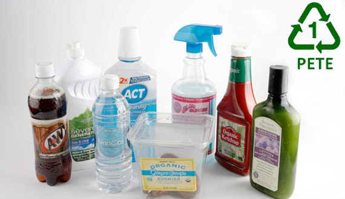
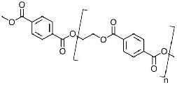

# Enzyme expression linear regression

**Enzyme expression linear regression tutorial for BIOL 318/418**

**This lesson uses synthetic teaching data** to practice a Bradford calibration and compare three
protein preparations. No earlier tutorial or laboratory measurements are required.

Polyethylene terephthalate (PET) is used in bottles, food packaging, and synthetic fibers. Its
persistence motivates research into biological recycling. In 2016, researchers described a
bacterium, *Ideonella sakaiensis*, capable of degrading and assimilating PET under the tested
conditions. PETase cleaves PET into smaller products; other enzymes can process those products
further. This does not mean PETase rapidly removes every kind of plastic from the environment.

You have just been hired at a small biotechnology startup working on PET recycling. Your team
engineers *Saccharomyces cerevisiae* to express a synthetic, yeast codon optimized PETase variant.
In this scenario, substitutions are intended to improve activity or stability. Three expression
strategies are being compared:

- **Strain A:** A single integrated gene copy at the HO locus under a TEF1 promoter produces
  intracellular His tagged PETase.
- **Strain B:** A high copy 2-micron plasmid with a PGK1 promoter and LEU2 marker produces
  intracellular His tagged PETase. High expression may impose a metabolic burden.
- **Strain C:** A low copy CEN plasmid with a GPD promoter and an alpha factor secretion signal
  directs His tagged PETase into the culture medium.

The fictional purification workflow harvests cells for strains A and B and retains culture
supernatant for strain C. Intracellular preparations undergo bead beating and clarification.
Protein precipitation, nickel affinity chromatography, and size exclusion chromatography enrich
the preparations. SDS-PAGE can assess their composition, but these samples remain described as
**partially purified**. The different recovery routes may have different losses and contaminants.

Your first assignment is to estimate protein concentrations in the three partially purified
preparations and compare their recovered protein masses. You will fit a BSA standard curve,
check the fit, and use its equation to convert absorbance into concentration.

The Bradford assay estimates **total protein**, not PETase alone. Its acidic Coomassie Brilliant
Blue G-250 reagent is mostly red/brown when free, absorbing around 465-470 nm. Protein binding
stabilizes the blue form, measured at 595 nm. Treat bovine serum albumin (BSA) standards and unknowns
with the same sample and dye volumes, timing, and assay conditions so their signals can be compared.
Different proteins can produce different dye responses, so the estimates
here are **BSA-equivalent total protein concentrations**. They cannot establish PETase activity,
purity, or the best producing strain without additional measurements.

Linear regression fits absorbance as a function of known concentration by minimizing squared
vertical residuals. We fit `y = m*x + b`, where `x` is concentration in mg/mL, `y` is blank corrected
absorbance, `m` is slope, and `b` is intercept. An unknown concentration is `(y - b)/m`. Concentration
means the solution before addition of dye, treated using the same assay volumes as the standards.

## Workbook

### Sheet: Bradford illustrative

| Synthetic BSA concentration (mg/mL) | Synthetic raw A595 | Blank corrected A595 |
| --- | --- | --- |
| 0 | 0.052 | |
| 0.125 | 0.153 | |
| 0.250 | 0.249 | |
| 0.375 | 0.354 | |
| 0.500 | 0.452 | |
| 0.625 | 0.550 | |
| 0.750 | 0.651 | |

#### At: F1

| Calibration statistic | Student value |
| --- | --- |

#### At: A12

| Synthetic sample | Synthetic raw A595 | Synthetic dilution factor | Synthetic recovered volume (mL) | Diluted protein (mg/mL) | Original protein (mg/mL) | Recovered protein (mg) |
| --- | --- | --- | --- | --- | --- | --- |
| Strain A | 0.292 | 5 | 3 | | | |
| Strain B | 0.454 | 10 | 2 | | | |
| Strain C | 0.372 | 5 | 4 | | | |

## Tutorial

### Part: Prepare the calibration

- **Worksheet:** Bradford illustrative

#### Step: Open your workbook

- **Open:** Upload this tutorial's generated XLSX workbook to Google Drive and open it in Google Sheets.
- **Choose:** File > Make a copy
- **Rename:** Add your name to the spreadsheet name so you have a personal working copy.
- **Locate:** Open the `Bradford illustrative` sheet in your copy.

#### Step: Inspect the dataset

- **Read:** All seeded concentrations, absorbances, dilution factors, and volumes are synthetic
  teaching values. No value is evidence about actual yeast strains.
- **Identify:** `A2:B8` holds BSA standards, including a zero protein reagent blank in row 2.
  `A13:D15` holds the three unknown preparations and their dilution information.
- **Explain:** In this exercise, each absorbance is a single illustrative reading. A real assay
  should include replicate standards and samples, matching buffers, consistent timing, and a
  validated working range for the specific reagent and format.
- **Check:** The stated nonzero teaching standards span 0.125 to 0.750 mg/mL. These bounds describe
  this dataset, rather than a universal Bradford linear range. Inspect the curve before assuming
  linearity; incompatible buffers, saturation, and protein composition can alter the response.

#### Step: Subtract the blank

- **Enter C2:** `=B2-$B$2`
- **Fill C2:C8:** Down
- **Do:** Select `C2:C8`, including the first formula, then press Ctrl+D (Windows) or Command+D
  (Mac). You can also drag the blue fill handle from `C2` to `C8`. The row in `B2` changes;
  `$B$2` stays fixed on the blank.
- **Check:** `C2` should be zero; `C8` should contain `=B8-$B$2` and show 0.599.
- **Explain:** The `$` anchors keep the zero protein reading fixed. The blank becomes zero after
  correction. Do not subtract the blank again from an already corrected reading.

#### Step: Plot the standards

- **Select:** `A1:A8`
- **Choose:** Insert > Chart
- **Choose:** Chart editor > Setup > Chart type > Scatter chart
- **Choose:** Chart editor > Setup > X-axis
- **Set:** Use `A2:A8` for the concentration axis and `C2:C8` for the only absorbance series.
  Remove any automatically selected raw absorbance series.
- **Choose:** Chart editor > Customize > Chart and axis titles
- **Name:** Give the chart the title "Illustrative Bradford calibration". Label the horizontal
  axis "BSA concentration (mg/mL)" and the vertical axis "Blank corrected A595".
- **Inspect:** Check that concentration is the horizontal numeric axis. A line chart with
  categories is not the intended graph. Check for curvature or isolated outliers.

#### Step: Fit a regression line

- **Label F2:** Slope (A595 per mg/mL)
- **Enter G2:** `=SLOPE(C2:C8,A2:A8)`
- **Label F3:** Intercept (A595)
- **Enter G3:** `=INTERCEPT(C2:C8,A2:A8)`
- **Label F4:** R squared
- **Enter G4:** `=RSQ(C2:C8,A2:A8)`
- **Open chart:** Double-click your scatterplot.
- **Choose:** Chart editor > Customize > Series > Trendline
- **Set:** Use a linear trendline, show its equation as the label, enable a legend, and show
  R squared.
- **Compare:** The chart equation should agree with `G2:G3` after allowing for displayed rounding.
  Use the spreadsheet coefficients for calculations to retain precision.
- **Explain:** R squared describes the fitted variation in absorbance explained by concentration
  for these standards. A value near 1 does not establish correct units, absence of systematic
  error, sample purity, or validity outside the calibration interval. Do not force the intercept
  to zero solely because you subtracted a blank.

#### Step: Examine residuals

- **Label I1:** Fitted A595
- **Label J1:** Residual A595
- **Enter I2:** `=$G$2*A2+$G$3`
- **Enter J2:** `=C2-I2`
- **Fill I2:J8:** Down
- **Do:** Select `I2:J8` and use the same Fill down shortcut. Each column copies its own first formula.
  The `$G$2` and `$G$3` references stay on the calibration coefficients.
- **Check:** The last row should contain `=$G$2*A8+$G$3` in `I8` and `=C8-I8` in `J8`.
- **Choose:** Insert > Chart
- **Set:** Create a second scatter chart using `A2:A8` as concentration and `J2:J8` as residuals.
- **Inspect:** Look for residuals scattered around zero. A curved pattern suggests that one
  straight line is inadequate; a high R squared alone would not resolve that problem. These few
  synthetic readings do not provide replicate based measurement uncertainty.

### Part: Estimate sample protein

- **Worksheet:** Bradford illustrative

#### Step: Check interpolation limits

- **Compare:** Subtract `B2` from each unknown raw reading in `B13:B15`. Confirm that each corrected
  result falls between the corrected nonzero standards in `C3:C8`.
- **Explain:** If a real unknown lies outside the validated range, repeat the assay at a suitable
  dilution, then record its new reading and dilution factor. Extrapolation can give a plausible
  number without reliable calibration support.

#### Step: Calculate diluted concentrations

- **Enter E13:** `=(B13-$B$2-$G$3)/$G$2`
- **Fill E13:E15:** Down
- **Explain:** Subtract the blank once from each raw sample reading, subtract the fitted
  intercept, and divide by the slope. The result is BSA-equivalent total protein in the diluted
  sample before dye addition, in mg/mL.

#### Step: Correct for dilution

- **Enter F13:** `=E13*C13`
- **Fill F13:F15:** Down
- **Explain:** A dilution factor of 5 means one volume of original preparation brought to five
  total volumes before the assay. Multiply the diluted concentration by that factor once. The
  common dye addition is already accounted for by treating standards and samples identically.
- **Compare:** Rank `F13:F15` as concentrations of the original recovered preparations. Do not
  rank raw absorbances alone when dilution factors differ.

#### Step: Calculate recovered total protein

- **Enter G13:** `=F13*D13`
- **Fill G13:G15:** Down
- **Check:** In row 15, the concentration formula should use `B15` with the same anchored blank
  and coefficients; `F15` should contain `=E15*C15`, and `G15` should contain `=F15*D15`.
- **Explain:** Multiplying concentration in mg/mL by the recovered preparation volume in mL
  gives BSA-equivalent recovered total protein in mg. This volume is the original undiluted
  preparation volume, rather than the volume of the diluted assay aliquot.
- **Compare:** Decide whether ranking the preparations by `G13:G15` gives the same result as
  ranking their concentrations. Explain why volume matters for a recovered mass.

#### Step: Interpret the limits

- **Check:** The slope should be about 0.7983 A595 per mg/mL. The dilution corrected
  concentrations should be about 1.50, 5.03, and 2.00 mg/mL for strains A, B, and C.
  If they differ substantially, check blank subtraction, anchored coefficients, and dilution factors.
- **Explain:** Write a short report naming the calibration slope, intercept, and R squared, then
  the three diluted concentrations, dilution corrected concentrations, and recovered masses.
  Give units and identify the data as synthetic.
- **Discuss:** Explain why the preparation with the most recovered total protein is not
  necessarily the preparation with the most PETase. Other proteins also bind Bradford dye, and
  PETase may respond differently than BSA.
- **Propose:** To compare PETase production per fermentation batch, measure PETase specific
  abundance or independently establish purity, account for recovery losses and culture volumes,
  and use independent biological replicates. To compare catalytic performance, measure enzyme
  activity under defined conditions. Total protein concentration alone answers neither question.
- **Submit:** Include both charts, the calculation cells, and your written interpretation.
  Preserve the formulas so the calculation can be checked.
