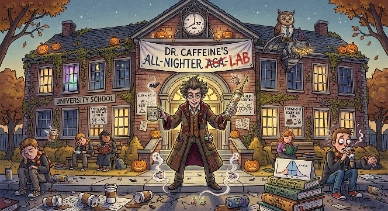

# Dr. Caffeine's academy: descriptive statistics

Welcome to All-Nighter Academy Orientation, where the coffee is strong, the students are exhausted,
and final exams are approaching! Before asking whether sleep predicts exam performance, summarize
what is typical and how much students vary. This is the first of three tutorials.

The workbook contains all 25 paired observations from the
[original class template](https://docs.google.com/spreadsheets/d/1mhOQhC_1hqnbvYItPT3y-V-_9l9q3pN7MtZDcOevaA0/edit?gid=0#gid=0).
No statistics are filled in for you. The data describe an association; they do not establish that
sleep causes a change in exam scores.

Original comic illustrations are retained for the story. Their drawn charts and labels are
illustrative, not calculated outputs; use the workbook data and your own charts as evidence.

## Workbook

### Sheet: Sleep and scores

| Hours of Sleep | Exam score (%) |
| --- | --- |
| 3 | 55 |
| 3.5 | 57 |
| 4 | 58 |
| 4 | 65 |
| 4.5 | 70 |
| 11 | 72 |
| 5 | 73 |
| 11.5 | 74 |
| 7 | 77 |
| 6 | 79 |
| 5.5 | 80 |
| 7.5 | 82 |
| 10 | 83 |
| 7 | 84 |
| 10.5 | 85 |
| 6.5 | 88 |
| 8 | 88 |
| 6.5 | 90 |
| 9.5 | 90 |
| 7.5 | 91 |
| 8 | 93 |
| 7 | 94 |
| 8.5 | 96 |
| 9 | 97 |
| 8.5 | 100 |

## Tutorial

### Part: Academy orientation

- **Worksheet:** Sleep and scores

#### Step: Set up your workspace

Before calculating statistics, create a personal workspace in which you can organize, analyze,
and interpret the data. You will use Google Sheets for calculations and visualizations.

- **Open:** Upload this tutorial's generated XLSX workbook to Google Drive and open it in Google Sheets.
- **Choose:** File > Make a copy
- **Rename:** Include your name and the date, for example Name_AllNighterAcademy_102126.
- **Inspect:** Find the Sleep and scores tab. Column `A` contains hours of sleep, and column `B`
  contains exam scores in percentage points. Each row is one student, so keep pairs together.
- **Check:** There are 25 observations in `A2:B26`. The first pair is 3 hours and 55%;
  the final pair is 8.5 hours and 100%.

#### Step: Calculate typical sleep

Descriptive statistics summarize the dataset before we examine a relationship. The mean is the
arithmetic average: add the values and divide by the number of students.

- **Label D1:** Statistic
- **Label E1:** Hours of sleep
- **Label F1:** Exam score (%)
- **Label D2:** Mean
- **Enter E2:** `=AVERAGE(A2:A26)`
- **Enter F2:** `=AVERAGE(B2:B26)`
- **Record:** Average hours of sleep = _____ hours. Average exam score = _____%.
- **Reflect:** Is average sleep higher or lower than you expected? What additional information
  would you need before deciding whether these students are getting enough sleep?

#### Step: Find the median

The median is the middle observation after sorting values. Unlike the mean, it is less affected
by unusually high or low observations. Do not sort just one original data column: that would
separate students' sleep and exam-score pairs.

- **Label D3:** Median
- **Enter E3:** `=MEDIAN(A2:A26)`
- **Enter F3:** `=MEDIAN(B2:B26)`
- **Record:** Median sleep = _____ hours. Median exam score = _____%.
- **Compare:** Are the median and mean similar for each variable? Explain how an unusually
  high or low observation could pull the mean away from the median.

#### Step: Measure variability

Measures of center describe a typical observation but do not show how much students differ.
The sample standard deviation describes spread around the mean, in the original measurement units.
A small standard deviation indicates observations cluster near the mean; a larger one indicates
more variability. We treat these students as a sample, so use the sample standard deviation.

- **Label D4:** Sample standard deviation
- **Enter E4:** `=STDEV.S(A2:A26)`
- **Enter F4:** `=STDEV.S(B2:B26)`
- **Record:** Standard deviation of sleep = _____ hours; standard deviation of scores = _____
  percentage points.
- **Explain:** What does each standard deviation tell you? Avoid comparing the two numerical
  values as if hours and percentage points were the same unit.
- **Reflect:** Can means, medians, and standard deviations alone tell you whether sleep and
  exam performance are related? Why would a plot of the paired observations help?

Congratulations! You have completed orientation. Continue with
[caffeine_2_linear_regression.md](caffeine_2_linear_regression.md), which supplies the same full
dataset and explores whether a straight line describes the relationship.
